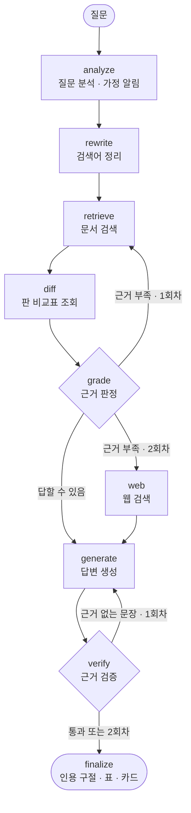

# 에이전트 구성 — 노드 흐름과 방법론

선급 문서 기술검토 에이전트(LangGraph)가 질문 하나를 어떤 노드로, 어떤 방법으로 처리하는지 정리한 문서다.
기준 코드는 `backend/agent/graph.py` · `agent/tools.py` · `agent/llm.py` · `agent/present.py` · `agent/logstore.py` · `rag/part1.py` · `rag/query_intent.py` · `rag/entities.py` (2026-10-12).

- 노드 8개: analyze → rewrite → retrieve → diff → grade → (web) → generate → verify
- 검색은 Part 1 보고서의 최종 통합 구성(E27 포함, test nDCG@10 0.988 · dev 1.000)을 그대로 쓴다
- LLM(Groq gpt-oss-120b)은 영어 검색 문장 · 근거 판정 · 답변 생성 · 근거 검증에만 쓴다. 나머지는 규칙과 검색 모델
- 재검색 1회, 재생성 1회가 상한이라 루프가 끝없이 돌지 않는다

## 1. 흐름

- diff는 판 비교 질문에서만 실행하고, 아니면 건너뛴다
- 2회차에도 근거가 부족한데 웹 검색이 꺼져 있거나 Tavily 키가 없으면 generate로 간다. 이때 generate는 지어내지 않고 "찾지 못함"으로 답한다
- finalize는 노드가 아니라 verify 끝에서 부르는 함수다. 최종 답이 정해진 뒤 화면에 보낼 것을 만든다

## 2. 노드 한눈에 보기

| 노드 | 하는 일 | 방법론 | LLM | 쓰는 것 |
|---|---|---|---|---|
| analyze | 선급 · 연도 · 의도 파악, 검색 문서 범위 결정, 가정 알림 | 규칙 기반 질의 이해, 메타데이터 필터, 막지 않는 되묻기 | 안 씀 | 정규식 |
| rewrite | 한국어 주제 쿼리 + 영어 검색 문장 | 쿼리 재작성, 한→영 교차 언어 질의, 구조화 출력, 자기 교정 | 씀 (캐시) | 정규식, gpt-oss-120b |
| retrieve | 관련 페이지 상위 50쪽 순위 | 하이브리드 검색(dense + sparse), RRF, 교차 인코더 리랭킹, 선급 균형 병합, 규칙 보정 | 안 씀 | 도구 `search_documents` — BGE-M3, FAISS 또는 Neon pgvector, bge-reranker-v2-m3 |
| diff | 판 비교 질문의 개정 기록 조회 | 구조화된 지식 조회 | 안 씀 | 도구 `edition_diff` — `kr_edition_diff.csv` |
| grade | 상위 쪽으로 답할 수 있는지 판정, 근거 쪽 선택 | CRAG식 검색 평가 + 조건 분기, 질의 기반 발췌 | 씀 | gpt-oss-120b |
| web | 문서 근거가 없을 때 외부 근거 수집 | CRAG식 웹 검색 보완 | 안 씀 | 도구 `web_search` — Tavily |
| generate | 문장마다 인용이 달린 답변 (+ 선급 비교표) | 근거 제한 생성, 문장 단위 인용, JSON 구조화 출력, 찾지 못함 처리 | 씀 | gpt-oss-120b |
| verify | 문장 · 비교표 행마다 근거 확인, 근거 없는 문장 처리 | LLM-as-a-judge + 규칙 검사, 자기 수정 루프 | 씀 | gpt-oss-120b, 정규식 |

## 3. 노드별 방법론

### 3.1 analyze — 질문 분석

규칙(정규식) 기반 질의 이해. LLM을 쓰지 않아 빠르고 결과가 항상 같다.

- **선급 감지**: KR · ABS와 한국선급 · 미국선급 · Korean Register · American Bureau. 없으면 모든 선급
- **연도 감지**: 20xx를 찾되, 바로 뒤 20자 안에 건조 · 취득 · 계약 · 인도 · 진수 · 용골(built, contract, deliver, keel)이 있으면 판 연도가 아닌 선박 사건 연도로 보고 뺀다
- **의도 분류** (구체적인 것부터 검사)
  - 판 비교: 같은 선급의 판 연도가 2개 이상이고 변화어가 있을 때. 최신판 연도 하나와 신설 · 삭제 · 변경어만 있어도 판 비교("2026년에 신설된" = 직전 판과 비교). 세부 의도는 신설 → 삭제 → 변경 → 차이 순
  - 선급 비교: 선급이 2개 이상이고 비교 · 차이어가 있을 때
  - 그 밖: 일반 질문
- **판 정책**: 신설 · 변경 · 차이 → 새 판 우선(구판 감점), 삭제 → 구판 우선. 의도가 없으면 `latest_boost`(연도를 말하면 그 판만, 말하지 않으면 모든 판을 찾되 구판 감점)
- **문서 범위(메타데이터 필터)**: 선급 · 연도로 검색할 문서를 정한다. 사용자가 화면에서 문서 범위를 고르면 그것을 쓴다
- **가정 · 되묻기** (`present.clarify`, 이벤트 `clarify`): 막지 않는 되묻기. 기본 가정으로 바로 답하면서, 어떤 가정을 했는지 알리고 다른 범위로 다시 물을 버튼을 준다
  - 질문에 선급이 없으면 "KR과 ABS를 모두 찾았다" + [KR 2026판만] [ABS 2025판만]
  - KR 질문인데 연도가 없으면 "KR 최신판(2026)을 우선했다" + [KR 2022판 기준으로 다시] [KR 2026판만]
  - 사용자가 문서 범위를 직접 고른 질문에는 하지 않는다
- **정답 연결**: 질문이 dev · test 질문과 같으면 qid와 정답 쪽을 붙여, 개발자 모드에서 4개 지표와 정답 쪽 순위를 보여 준다

### 3.2 rewrite — 검색어 정리

쿼리 재작성 + 한→영 교차 언어 질의. 문서가 영어라서 한국어 질문을 규정 용어로 옮긴 영어 검색 문장을 하나 더 만든다.

- **한국어 주제 쿼리 (규칙)**
  - 선급명, "선급 기준", 연도 구절("2022년과 비교하여", "in 2022", "between 2022 and 2026")을 통째로 지운다. Part 1의 Q10 진단(메타 용어가 dense · 리랭커 질의를 흐림)에서 나온 처리
  - 판 비교 질문은 변화어(신설 · 삭제 · 바뀐 …)와 질문 꼬리("무엇?", "is there any")도 지운다. 페이지 본문에는 "신설" 같은 표시가 없기 때문
  - 비교 · 차이 같은 의도어를 지운다
- **영어 검색 문장 (LLM)**
  - gpt-oss-120b가 질문을 `query_en` · `intent` · `societies` · `years` 네 필드의 JSON으로 나눈다. 선급 · 연도 · 비교어는 다른 필드로 빼고, `query_en`에는 주제(선종 · 장비 · 용도 · 노테이션 이름)만 남긴다
  - 자기 교정: `query_en`에 연도 · 선급명 · 비교어가 남아 있으면 그 목록을 알려 주고 한 번 다시 요청한다. 그래도 남은 것은 정규식으로 지운다
  - 같은 질문은 캐시(`query_struct.json` + `cache_runtime/`)에서 꺼내 쓴다. 키가 없거나 한도에 걸리면 한국어 쿼리만으로 진행한다
- 노드를 끄면 원 질문 그대로 검색한다 (비교용)

### 3.3 retrieve — 문서 검색 (도구 `search_documents`)

Part 1 보고서의 최종 통합 구성을 그대로 쓴다. 하이브리드 검색 → RRF → 교차 인코더 리랭킹 → 규칙 보정 순.

1. **색인 (E13 구조 기반 청크)**
   - KR: 청크 앞에 제목 경로(절 > 블록)를 붙이고, 표 행은 머리행을 이용해 "열: 값"으로 펼친다
   - ABS: 구조 기반 청크(최대 1,200자)
   - BGE-M3 dense 벡터(FAISS IndexFlatIP)와 BGE-M3 sparse 가중치. `DATABASE_URL`이 있으면 Neon(PostgreSQL + pgvector)으로 1단계 검색을 하고, 청크 수가 다르거나 접속이 안 되면 FAISS로 돌아간다
2. **1단계 검색**: analyze가 정한 문서 안에서 dense · sparse 채널마다 쪽 단위 상위 50쪽 → RRF(k=60)로 합침 → 감점 판 쪽은 점수 ×0.5
3. **리랭킹**: bge-reranker-v2-m3가 상위 50쪽을 한국어 쿼리와 영어 쿼리로 각각 다시 매기고, 두 순위를 RRF로 합친다
4. **선급 비교 병합 (E27, 선급 비교 질문만)**: 리랭커 원점수를 선급별로 z-표준화(구판 감점 쪽은 평균 · 표준편차 계산에서 뺌) → 한 · 영 평균 → 시그모이드 → 원래 순위 점수(1위 1.0 → 꼴찌 0.0)와 50:50으로 섞어 다시 줄 세운다. 한 선급이 상위를 독차지해 다른 선급 근거가 빠지는 것을 막는다
5. **판 비교 보정 (E12-4, 판 비교 질문만)**: 우선 판의 쪽 중 개정표에 해당 종류(신설 등)로 기록된 쪽을 상위 50쪽 안에서 맨 앞으로 올린다
6. **구판 감점**: 감점 판의 쪽을 상위 50쪽 안에서 뒤로 보낸다. 리랭커는 판을 구분하지 못하므로 리랭크 뒤에 다시 적용한다

- **재검색 (2회차)**: grade가 근거 부족으로 판정하면 영어 검색 문장을 주 질문으로 쓰고, 질문의 선급은 유지한 채 판(연도) 제한을 풀어 모든 판에서 찾는다
- dev · test 질문이면 E9 기준 구성 결과도 함께 내보내 화면에서 두 구성을 비교할 수 있게 한다
- 리랭커 점수는 캐시한다(제출 캐시는 읽기만, 새 질문은 `cache_runtime/`). 장치는 xpu → cuda → cpu 순으로 자동 선택

### 3.4 diff — 판 비교표 조회 (도구 `edition_diff`)

구조화된 지식 조회. 페이지 본문만으로는 두 판 사이에 무엇이 바뀌었는지 보이지 않아, 미리 만든 개정표를 근거로 함께 넘긴다.

- 판 비교 질문에서만 실행한다
- 개정표 `kr_edition_diff.csv`: Part 1에서 KR 2022 · 2026 본문을 규칙으로 대조해 만든 93건(신설 55 · 요건 변경 19 · 명칭 변경 10 · 삭제 9). 같은 판정을 PostgreSQL 안에서 하는 실험은 `db/edition_diff/`
- 검색 상위 10쪽과 관련된 행 중 질문 의도에 맞는 종류만 고른다(신설 → 신설 · 명칭 변경, 삭제 → 삭제 · 명칭 변경, 변경 → 요건 변경 · 명칭 변경, 차이 → 전부)
- 검색 순위가 높은 쪽의 행부터 최대 12행을 넘긴다

### 3.5 grade — 근거 판정

CRAG(Corrective RAG)식 검색 결과 평가. LLM이 검색 결과로 답할 수 있는지 판정하고, 그 결과로 다음 노드를 고른다.

- **판정 대상**: 상위 5쪽. 선급 비교 질문은 8쪽을 고르고 선급마다 최소 2쪽을 넣는다
- **입력 압축 (질의 기반 발췌)**: 쪽마다 900자. 머리 2줄 + 질문 단어가 많이 나오는 줄을 골라 원래 순서대로 이어 붙인다. 판 비교 질문이면 개정표도 함께 준다
- **출력 JSON**: `answerable`, `relevant_pages`(최대 4쪽 · 선급 비교는 6쪽), `reason`(한국어 한 문장)
- **판정 기준**: 부분 답과 "목록에 없음"이라는 답도 답할 수 있음으로 본다. 주제 · 선종 · 선급이 다를 때만 false
- **분기**: 답할 수 있음 → generate (고른 쪽만 근거로) · 근거 부족 1회차 → retrieve 재검색 · 근거 부족 2회차 → web(켜져 있고 Tavily 키가 있을 때), 아니면 generate
- 노드를 끄거나 키가 없으면 상위 4쪽을 그대로 근거로 쓴다

### 3.6 web — 웹 검색 (도구 `web_search`)

CRAG의 웹 검색 보완. 문서에서 두 번 다 근거를 못 찾았을 때만 실행한다.

- Tavily로 "영어 검색 문장 + classification society notation"을 검색, 3건, 각 900자
- 결과에 `web:1`, `web:2` … id를 달아 문서 근거와 구분해 표시한다

### 3.7 generate — 답변 생성

근거 제한 생성(grounded generation) + 문장 단위 인용 + JSON 구조화 출력.

- **찾지 못함** (이벤트 `not_found`): 재검색까지 했는데도 근거 판정이 실패하고 웹 결과도 없으면, LLM을 부르지 않고 "찾지 못했다"로 답한다. 이유와 가까운 쪽 5개만 안내한다
- **근거**: grade가 고른 쪽(쪽마다 1,500자 발췌) + 개정표(`tool:edition-diff`) + 웹 결과
- **출력 형식**: `{"sentences": [{"text": "…", "cites": ["KR2026:233", "tool:edition-diff"]}]}`
- **프롬프트 규칙**
  - 주어진 근거만 쓰고 바깥 지식은 쓰지 않는다. 2–6문장, 직접 답을 먼저
  - 사실을 말하는 문장마다 근거 id를 1개 이상 인용한다
  - 노테이션은 원문에 정확히 같은 이름이 있어야 존재 · 적용된다고 본다(비슷한 기호는 다른 노테이션)
  - 판 비교 질문은 개정표를 기준으로 답한다. 근거에 답이 없으면 없다고 한 문장으로 말하고 추측하지 않는다
- **선급 비교표**: 질문에 선급이 둘 이상 적혀 있으면 같은 JSON에 `table`(2–5행, 항목 · 선급별 짧은 값 · 인용)도 만들게 한다. 근거에 없는 칸은 "-"
- **답변 언어**: 질문에 한글이 있으면 한국어, 없으면 영어로 지정한다
- **후처리**: 본문에 끼워 쓴 "(ABS2025:26)" 같은 id는 떼어 cites로 옮기고, 근거 목록에 없는 id는 버린다
- **2회차**: verify가 넘긴 "근거 없는 문장" 목록과 이유를 붙여, 그 주장을 빼고 다시 쓰게 한다

### 3.8 verify — 근거 검증

LLM-as-a-judge 문장 단위 검증 + 규칙 검사 → 자기 수정 루프(Self-RAG의 비평 단계와 비슷한 역할).

- **LLM 판정**: 문장마다 supported(근거 확인) · inferred(추론) · unsupported(근거 없음) + 한국어 메모. 선급 비교표의 행도 문장처럼 이어 붙여 함께 판정한다
- **규칙 검사 1**: 인용이 없는 문장은 supported가 될 수 없다 → inferred
- **규칙 검사 2**: 문장에 나온 노테이션 같은 표기(대문자 2개 이상, 질문에 있던 표기와 KR · ABS 등은 제외)가 인용 원문에 없으면 unsupported로 내린다. LLM 판정이 놓치는 노테이션 이름 할루시네이션을 잡기 위함
- **분기**: unsupported가 있고 1회차 → generate로 돌아가 다시 생성(1회) · 2회차에도 남으면 그 문장을 답변에서 빼고 알림을 띄움 · 그 밖 → 끝(finalize)

## 4. 답을 보여 주는 형태 — finalize

최종 답이 정해지면 `graph.finalize`가 화면용 이벤트를 보낸다 (계산은 `agent/present.py` · `rag/entities.py`, LLM 없음).

| 질문 유형 | 이벤트 | 만드는 법 |
|---|---|---|
| 모든 답 | `passages` (인용 구절) | 문장마다, 인용한 쪽의 청크 · 문단 중 문장과 가장 비슷한 구절. 점수 = BGE-M3 dense 유사도 + 0.25 × 영문 · 코드 낱말 겹침(`LS(CL)`과 `LS(CL, RS+)` 같은 코드 차이를 가르려고). 웹이 원본 PDF에서 그 줄을 노랗게 칠한다 |
| 판 비교 | `table` (변경 표) | 판 비교표 도구의 행을 그대로. 답변이 인용했거나 근거 판정이 고른 쪽의 행만 (없으면 전부) |
| 선급 비교 | `table` (비교표) | generate가 만든 표 + 행마다 verify 판정 |
| 그 밖 | `cards` (노테이션 카드) | 답변 문장에 이름이 나온 노테이션 중 그 문장이 인용한 쪽에 있는 것. 엔티티 표는 문서의 표 · 목록에서 규칙으로 뽑음(실험 E29와 같은 규칙, 검색 순위에는 쓰지 않음) |
| 찾지 못함 | (없음) | 표 · 카드를 만들지 않는다 |

## 5. 실행 기록과 피드백

- 서버가 질문마다 `run_id`를 붙이고, 화면에 나간 이벤트를 모아 `agent_runs`(질문 · 문서 범위 · qid · 상위 10쪽 · 문장과 판정 · 표 · 카드 · 찾지 못함 · 노드별 설명 · 걸린 시간)에 저장한다
- 답변 아래 👍👎와 사유는 `POST /feedback`으로 `agent_feedback`에 `run_id`로 이어 저장한다
- 저장 위치: 로컬 PostgreSQL `localhost:5433/hdrag`(`LOG_DATABASE_URL`로 바꿈). 접속이 안 되면 `backend/cache_runtime/logs/*.jsonl` (`agent/logstore.py`)
- 쌓인 기록은 dev 질문 보강과 실패 분석의 재료다

## 6. 공통 사항

- **LLM**: Groq `openai/gpt-oss-120b`(langchain_groq ChatGroq), temperature 0, JSON 모드, reasoning_effort low. 답변 생성은 기본 모델, 근거 판정 · 검증은 `GROQ_MODEL_FAST`(기본값은 같은 모델)
- **한도 대응**: 무료 한도에 걸려 20초 넘게 기다려야 하면 `gpt-oss-20b` → `qwen3.8-27b`로 넘어간다. 어떤 모델로 답했는지 노드 설명에 적는다
- **LLM 호출 위치**: rewrite(영어 문장, 캐시) · grade · generate · verify. 질문 하나당 많아야 8번(rewrite 2 · grade 2 · generate 2 · verify 2, 한도 재시도 제외)
- **노드 켜고 끄기**: 화면에서 rewrite · diff · grade · web · verify를 끌 수 있어 노드별 효과를 바로 비교할 수 있다
- **진행 표시**: 각 노드가 `get_stream_writer`로 진행 이벤트를 보내고, FastAPI가 SSE로 웹에 넘긴다. 이벤트 형식은 `web/src/lib/types.ts`의 `AskEvent`

## 7. 도구 호출 방식 (미결)

세 도구(`search_documents` · `edition_diff` · `web_search`)는 LangChain `@tool`로 만들었지만, LLM이 도구를 고르는 tool-calling이 아니라 노드가 정해진 순서로 직접 부른다(결정적 도구 호출).
과제 채점 기준의 "질의–도구호출–응답"을 이 방식으로 설명할지, LLM tool-calling 노드를 추가할지는 아직 정하지 않았다.

## 8. 코드 위치

| 파일 (`backend/`) | 내용 |
|---|---|
| `agent/graph.py` | 노드 8개, 분기 함수 2개(`after_grade` · `after_verify`), finalize, 프롬프트(근거 판정 · 답변 생성 · 비교표 · 근거 검증), 그래프 구성 |
| `agent/tools.py` | 도구 3개, 질의 기반 발췌(`excerpt`) |
| `agent/llm.py` | Groq 호출, JSON 파싱, 대체 모델 전환 |
| `agent/present.py` | 인용 구절, 변경 표, 가정 · 되묻기 |
| `agent/logstore.py` | 실행 기록 · 피드백 저장 |
| `rag/part1.py` | Part 1 검색기 이식(색인, `search_v2`, E27 병합, 영어 검색 문장) |
| `rag/query_intent.py` | 판 비교 · 선급 비교 의도 감지, 주제 쿼리 규칙 |
| `rag/entities.py` | 노테이션 엔티티 표, 노테이션 카드 |
| `rag/pg_index.py` | Neon(pgvector) 1단계 검색 |
| `server.py` | FastAPI, SSE 스트리밍, 실행 기록 모으기, `/feedback` |
| `tests/test_graph_fake.py` | 가짜 LLM으로 모든 분기 검사 |
