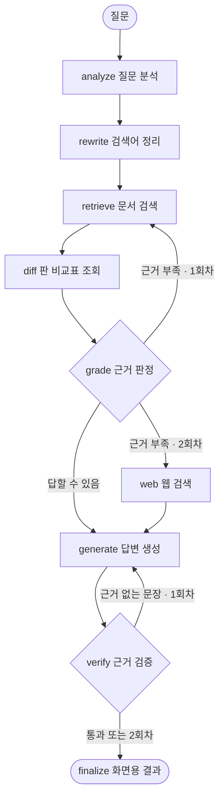

# 선급 문서 검색 · 기술검토 시스템 — 설계 결정 기록 (채택 · 비채택)

> 2026-10-13. 2026 울산대학교 DT인력양성과정 과제(출제 HD한국조선해양 AXC)의 **검색 방법 · DB · 에이전트 · 노션**에서 내린 결정을 **채택 그룹**과 **비채택 그룹**으로 나누고, 연구자 입장에서 근거와 이유를 기록함
> - 항목마다: 문제(가설) → 한 일 → 근거(증거 등급) → 판정 이유 → 한계. 비채택 항목에는 "다시 볼 조건"을 붙임
> - 지나간 진행 기록, 중간 구성, 날짜별 변화는 뺐음. 숫자는 판정에 쓰인 비교값만 남김
> - 기준: 코드 [`710pkj/hd-rag-part2`](https://github.com/710pkj/hd-rag-part2) 커밋 `67da6d9` · 로컬 DB 2026-10-13 조회 · 실험 결과 Drive `HD융캡디/outputs/`

---

## 목차

0. 판정 원칙 — 무엇을 근거로 채택했나
1. 한눈에 — 채택 · 비채택 요약
2. 검색 방법 (에이전트 검색 도구의 내부)
3. DB
4. 에이전트
5. 노션
6. 연구자 소견 — 무엇이 통했고, 무엇을 아직 모르나
7. 현재 상태와 남은 일
부록 A. 채택 구성의 명세 · 부록 B. 주소 · 부록 C. 용어

---

## 0. 판정 원칙 — 무엇을 근거로 채택했나

### 0.1 연구 질문

| | 질문 | 재는 법 |
|---|---|---|
| RQ1 검색 | 한국어 질문으로 영어 선급 노테이션 문서 3종(KR 2022 · 2026, ABS 2025, 938쪽)에서 정답 쪽을 상위 10 안에, 등급 순서대로 올릴 수 있나 | nDCG@10 (주 지표), R@10 · MRR@10 · P@10. 임베딩 bge-m3 · top-10은 과제가 고정 |
| RQ2 DB | 검색 결과를 바꾸지 않고 저장 · 후보 검색을 SQL로 옮겨, 앞으로 들어올 데이터를 같은 규칙으로 처리할 수 있나 | 기존 결과와의 동등성(순위 · 바이트) |
| RQ3 에이전트 | 찾은 근거만으로 답하고, 근거 없는 문장을 스스로 걸러 낼 수 있나 | 분기 시험, 실제 LLM으로 test 질문 확인 |
| RQ4 기록 | 판단 근거를 제3자가 다시 따라갈 수 있게 남길 수 있나 | 숫자의 출처 · 성격이 모든 표에 드러나는가 |

### 0.2 증거의 등급

| 등급 | 뜻 | 강도 |
|---|---|---|
| **A** | dev(직접 만든 27문항)에서 **실행 전에 정한 규칙**을 통과 | 가장 강함 |
| **B** | **동등성 검증**: 바꾼 뒤에도 순위 · 바이트까지 같음 | 인프라 변경에 필요 · 충분 |
| **C** | test(과제 10문항) 기준 통합 — **사후 · 낙관적** | 약함. 새 질문 성능의 근거가 아님 |
| **D** | **실사용 관찰**: 실제 LLM으로 돌려 실패를 보고 고침 + 기능 시험 | 정성적 |
| **E** | **설계 판단**: 요구 조건 · 비용 · 위험을 비교해 고름 (수치 실험 없음) | 논리적 근거만 |

### 0.3 채택 규칙

| 규칙 | 내용 | 성격 |
|---|---|---|
| 기본 규칙 | dev nDCG@10이 한 문항 몫(1/27 ≈ 0.037)보다 크게 올라야 채택. 전처리부터 E9까지의 채택(S1–S6)도 모두 이 기준을 넘음 | 실행 전에 정함 |
| 재판정 규칙 (v2) | 위 기준 + 50위까지의 순위 점수(nDCG@50) 상승 + R@10 · MRR@10이 한 문항 몫 이상 떨어지지 않음. 기준에 못 미쳐도 순위가 오르면 **보류**, dev 정답 순위가 하나도 안 바뀌면 **판단 불가** | 결과를 본 뒤 고친 규칙(10위 밖에서만 오른 방법을 놓치지 않으려고). 그렇다고 밝혀 둠 |
| 묶음 후보 | 개별로는 기준 미달인 장치 넷을 합친 구성을 "미리 정한 후보" 하나로 고정해 묶음으로 판정 | 같은 dev에서 변형을 계속 고르는 다중 비교를 막으려고 |
| test 기준 통합 | test nDCG@10 · @50이 오르고 R@10 · MRR@10이 0.1 이상 떨어지지 않으면 채택 | **사후 · 낙관적**. 이 규칙으로만 들어온 장치는 C등급으로 따로 표시 |
| 나중 실험의 사전 등록 | E26 · E27: 재판정 규칙 뒤 dev에서 내린 문항이 하나라도 있으면 기각. E29 · E30: E9 바탕 dev +1/27 이상이고 최종 구성 dev가 내려가지 않으면 채택 (평가 스크립트 머리에 고정) | 실행 전에 정함 |
| 인프라 변경 | 검색 결과가 바뀌면 안 됨 → 동등성(B)을 먼저 확인 | DB · 에이전트 |

### 0.4 비채택 안의 구분

| 표시 | 뜻 |
|---|---|
| **기각** | 근거가 가설을 반박함 (dev 하락, 기준 미달 + 부작용, 원인 확인) |
| **보류** | 방향은 맞지만 지금 평가 집합으로는 기준을 넘길 수 없음 → dev 보강 뒤 다시 판단 |
| **판단 불가** | dev 정답 순위가 하나도 안 바뀌어 효과를 잴 수 없음 |
| **대안 탈락** | 설계 단계에서 다른 선택지와 비교해 고르지 않음 (수치 실험 없이) |

### 0.5 숫자의 성격과 타당성 위협

| 구성 | 정한 방법 | test nDCG@10 | dev nDCG@10 |
|---|---|---|---|
| E0 베이스라인 | — | 0.326 | 0.473 |
| **E9 기준 구성 (보고 값)** | dev 규칙 | **0.823** | 0.914 |
| 미리 정한 후보 | dev로 고정 (아이디어 대부분은 test 분석에서 나옴) | 0.944 | 0.995 |
| 최종 통합 (에이전트가 쓰는 구성) | test로 장치를 고름 (사후 · 상한) | 0.988 | 1.000 |

1. **표본**: test 한 문항이 평균을 0.1, dev 한 문항이 0.037 움직임. 신뢰구간 · 통계 검정은 내지 않음
2. **dev 포화 · 편향**: dev 27문항 중 24문항이 정답 1쪽, 판 비교는 쉬운 1문항(d11), 선급 비교는 2문항(d26 · d27). 판 비교 · 선급 비교 장치의 효과는 dev로 잴 수 없음 (최종 dev 1.000)
3. **다중 비교 · 적응**: 같은 dev에서 여러 변형을 시험했고, 앞 변형 결과를 보고 다음 변형을 고친 경우가 있음(영어 질의 v1 → v2)
4. **test에서 나온 아이디어**: E9, 판 비교 처리, 구조 기반 청킹, 리랭커 한 · 영 결합, 의도어 빼기, 리랭크 뒤 구판 감점(계기), 선급 비교 병합
5. **바탕 의존**: 같은 장치가 바탕에 따라 효과가 뒤집힘 (의도어 빼기 A, 선급 비교 병합, 검색에도 영어 질문)
6. **정답표의 한계**: Q10 정답표가 좁음 (ABS 17쪽 ABCU 같은 실제 자동화 노테이션이 빠짐). Q10을 1.00으로 만드는 것은 정답표에 맞추는 일이라 쫓지 않음
7. **dev · test 판정 불일치**: 같은 규칙으로 판정하면 60개 구성 중 32개에서 판정이 다름. 전처리 · struct 청킹은 dev 채택이지만 test로는 기각

---

## 1. 한눈에 — 채택 · 비채택 요약

| 영역 | 채택 그룹 | 비채택 그룹 |
|---|---|---|
| 검색 방법 | S1 전처리 규칙 · S2 dense + sparse(RRF) · S3 선급 · 판 필터 · S4 struct 청킹 · S5 크로스 인코더 리랭커 · S6 메타 낱말 빼기(E9) · [묶음] S7 판 비교 처리 · S8 구조 기반 청킹 · S9 리랭커 한 · 영 결합 · S10 리랭크 뒤 구판 감점 · [사후] S11 의도어 빼기 A · S12 선급 비교 병합(E27) | 어휘 채널 · 사전 6 · 청킹 · 문맥 5 · 리랭크 방식 · 모델 5 · LLM 활용 6 · 질의 · 판 규칙 변형 5 · 선급 비교 변형 4 · 새 색인 · 채널 2 |
| DB | D1 PostgreSQL + pgvector · D2 검색용 Neon · D3 로컬 PostgreSQL · D4 옮길 범위 · D5 동등성 우선 결정 · D6 청크 단위 벡터 · D7 표 분리 규칙 · D8 처리 버전 · 해시 · D9 리랭커 점수 표 · D10 정확 검색 · D11 대신 경로 · D12 판본 비교 판정을 SQL로 · D13 실행 기록 | 다른 DB 서비스 · 코사인 거리 · halfvec · 근사 색인 · 모델 단계까지 SQL로 · "SQL이면 판본 비교 불필요" · 다른 유사도 함수 · 다른 로컬 설치 방식 · 실행 기록 공개 |
| 에이전트 | A1 고정 흐름 + 분기 · A2 검색 그대로 이식 · A3 결정적 도구 호출 · A4 LLM 네 곳 · A5 규칙 질문 분석 · A6 재검색 정책 · A7 근거 판정 정책 · A8 웹은 마지막 · A9 근거 제한 생성 · A10 문장 검증 · A11 찾지 못함 · A12 막지 않는 되묻기 · A13 유형별 답 형태 · A14 실행 기록 · A15 서버 동시성 · A16 로컬 GPU · A17 웹 · 실행 | LLM tool-calling · 분석에 LLM · 검색 순서에 LLM · 무제한 루프 · 근거 없이 생성 · 먼저 묻기 · 엔티티 · 예상 질문 색인 · 늘 비교표 · 전체 개정 행 · CPU 리랭크 · 응답 생성기 안 실행 · 동시 처리 · 첨부 처리 · 노션 안 에이전트 · 브라우저 기본 스크롤 |
| 노션 | N1 최종 보고서와 근거 기록 분리 · N2 고정 틀 · N3 비채택도 같은 무게 · N4 숫자의 성격 표시 · N5 결과 파일 · 스크립트 · N6 독자별 페이지 · N7 원본 하나 · N8 표기 규칙 | 상세 기록을 보고서로 · 최고 test 값을 대표로 · 다른 팀 숫자와 직접 비교 · 파이프 표 · 손으로 옮긴 숫자 |

---

## 2. 검색 방법 (에이전트 검색 도구의 내부)

에이전트의 도구 `search_documents`는 아래 채택 구성을 그대로 씀. 노션 보고서의 네 구성 × 37문항이 백엔드에서 37/37 같게 나오는 것으로 확인함(B).

```
질문 → [S3 선급 · 판 필터] → [S6 메타 낱말 빼기 · S11 의도어 빼기 · 판 비교 주제 질의]
     → 1단계: [S2 dense + sparse → RRF] (색인: S1 전처리 · S4/S8 청킹) → 상위 50쪽
     → 2단계: [S5 리랭커 × S9 한국어 · 영어 → RRF]
     → [S12 선급 비교 병합] → [S7 판 비교 보정] → [S10 구판 뒤로] → 상위 10쪽
```

### 2.1 채택 그룹 — 요약

| ID | 방법 | 증거 | 판정 근거 (dev / test) | 최종에서 빼면 (test / dev) |
|---|---|---|---|---|
| S1 | 전처리 규칙 (파싱 오류 복원 11개 + 첫 글자 붙이기) | A | dev 0.473 → 0.532 / test 0.326 → 0.247 | — |
| S2 | dense + sparse를 RRF로 결합 | A | dev 0.532 → 0.679, R@10 0.68 → 0.86 | — |
| S3 | 선급 · 판 연도 필터 + 연도 없으면 구판 감점 | A | dev 0.679 → 0.783 (정책 다섯 가지 중 최고) | — |
| S4 | struct 청킹 (KR 표 한 행 = 한 청크) | A | dev 0.783 → 0.822, R@10 0.86 → 0.94 | — |
| S5 | 크로스 인코더 리랭커 bge-reranker-v2-m3 | A | dev 0.822 → 0.862 / test 0.492 → 0.709 | — |
| S6 | dense · 리랭커 질의에서 메타 낱말 빼기 (E9) | A (아이디어는 test) | dev 0.862 → 0.914 / test 0.709 → 0.823 | — |
| S7 | 판 비교 처리 — 개정 요약표로 올리기 (E12-4) | A(묶음) · dev로 잴 수 없음 | E9 위 test 0.823 → 0.918, dev 변화 0 | −0.115 / 0 |
| S8 | 구조 기반 청킹 — 절 제목 물려주기 · 표 행 "열: 값" (E13-2) | A(묶음) | E9 위 dev +0.014 | −0.045 / −0.037 |
| S9 | 리랭커 한 · 영 결합 (영어 질의 v2) | A(묶음) | E9 위 dev +0.017 / test +0.044 | −0.029 / −0.042 |
| S10 | 리랭크 뒤 구판 감점 (E17) | A(묶음) | E9 위 dev +0.021, 내린 문항 0 | −0.027 / −0.027 |
| 묶음 | S7–S10 = 미리 정한 후보 | **A** | **dev 0.914 → 0.995** / test 0.823 → 0.944 | |
| S11 | 의도어 빼기 A (E16) | **C (사후)** | 후보 위 test 0.944 → 0.974, dev +0.003 | −0.038 / −0.005 |
| S12 | 선급 비교 병합 (E27) | **C (사후)** | 위 test 0.974 → 0.988, dev 0.998 → 1.000 | −0.013 / −0.002 |

"최종에서 빼면"은 최종 통합에서 그 장치 하나만 뺐을 때의 변화(LOO)로, 최종 구성에서 그 장치가 하는 몫임.

### 2.2 채택 그룹 — 항목별

#### S1 전처리 규칙 — 채택 (A)

- **문제**: 과제 텍스트에 파싱 오류가 있음. ABS 기호가 깨짐(À = ✠ 1,936회, Á = Ⓔ, Â = Ⓜ, Ã = Ⓟ), ABS 굵은 첫 글자가 떨어짐("A utomatic C entralized C ontrol", 115쪽 472곳), KR 파서 잔재(MARKDOWN 태그, 표 안 줄바꿈 태그 약 740개)
- **가설**: 노테이션 이름이 깨지면 정확한 표기 일치(sparse)와 리랭커의 판단이 모두 흔들림
- **한 일**: `rules.csv`의 repair 5개(깨진 기호 4개 · 파서 잔재) + normalize 6개(위첨자 각주 4개 · 표 안 줄바꿈 · 이미지 자리표시) + 첫 글자 붙이기(떨어진 조각이 코퍼스에서 단독 낱말로 쓰이지 않을 때만). 처리 순서를 규칙으로 고정: repair → 위첨자 각주 삭제 → NFKC(복원한 기호 보호) → normalize → 첫 글자 붙이기. NFKC를 먼저 하면 복원한 Ⓔ · Ⓜ · Ⓟ가 E · M · P로, 각주 "Pt 3¹⁾"가 "Pt 31)"로 바뀌기 때문
- **근거**: dev 0.473 → 0.532(+0.059), MRR 0.42 → 0.50. ABS 문항이 크게 오름(d18 145쪽 18위 → 1위, d23 212쪽 12위 → 1위)
- **판정 이유**: 기준(+0.037)을 넘고, 오른 문항이 깨진 표기가 있던 ABS 쪽이라 가설과 맞음
- **한계**: test는 0.326 → 0.247로 내림(사후). 규칙을 test를 보고 만들지 않았고 dev로 정한다는 원칙에 따라 유지함. 규칙은 코퍼스만 보고 만들고 규칙마다 근거 쪽 · 인용문을 남김

#### S2 dense + sparse 결합(RRF) — 채택 (A)

- **문제**: 질문은 한국어, 문서는 영어라 낱말 일치 검색은 한국어 질문에서 거의 쓸모가 없음. 하지만 WHIP+, LPG Ready처럼 영문 · 코드가 섞인 질문은 정확한 표기 일치가 필요함
- **가설**: 뜻(dense)과 표기(sparse)는 서로 다른 쪽을 찾으므로 합치면 놓치는 정답이 줄어듦
- **한 일**: BGE-M3가 한 번에 내는 dense · sparse로 채널마다 상위 50쪽을 받아, 점수 척도가 달라 점수 대신 순위로 합침(RRF, k=60). 어휘 채널 질의에서는 메타 낱말(KR, ABS, notation, 연도)을 뺌
- **근거**: dev 0.532 → 0.679, R@10 0.68 → 0.86. 대안 dense + BM25 0.608, 셋 다 0.647. 메타 낱말을 남기면 BM25 단독 dev 0.420 → 0.348 (거의 모든 쪽에 나오는 말이라 순위를 흐림)
- **판정 이유**: R@10 상승이 주효과 → dense가 놓친 쪽을 sparse가 노테이션 이름으로 찾음
- **한계**: 한국어로만 된 질문은 sparse가 비어 dense만 씀. BM25 결합은 test에서 더 높았음(사후, SX1)

#### S3 선급 · 판 연도 필터 + 구판 감점 — 채택 (A)

- **문제**: KR 2022 · 2026판의 같은 절은 거의 같은 내용이라, 연도 없는 질문에서 2022판 쌍둥이 쪽이 상위 자리를 나눠 가짐. 선급을 말한 질문에도 다른 선급 쪽이 끼어듦
- **한 일**: 질문에서 선급 · 판 연도를 규칙으로 읽어 볼 문서를 정함(필터 = 어디를 볼지, 검색어 = 무엇을 찾을지). 판 연도가 있으면 그 판만, 없으면 최신판 우선 + 구판 점수 ×0.5. "2024년에 취득한"처럼 건조 · 취득 · 계약 · 인도 · 진수 · 용골이 붙은 연도는 판 연도로 보지 않음
- **근거** (연도 정책 다섯 가지, dev / test 사후): 선급 필터만 0.702 / 0.441 · 그 판만 0.742 / 0.491 · 최신판만 0.770 / 0.500 · **구판 감점 0.783 / 0.500** · 질문의 모든 연도를 판으로 0.742 / 0.391
- **판정 이유**: 최신판만 보면 구판에만 있는 내용을 잃고, 사건 연도를 판으로 읽으면 Q4의 "2024년"이 2022판으로 감. 감점은 구판을 후보에 남겨 두면서 최신판을 앞세움
- **한계**: 감점이 1단계 점수에만 걸려, 판을 모르는 리랭커 뒤에서 동점이 남음 → S10으로 보완

#### S4 struct 청킹 — 채택 (A)

- **문제**: KR Ch 3 · 4는 표 한 장에 노테이션 10여 개가 행으로 들어 있음. 쪽 하나를 벡터 하나로 만들면 질문과 맞는 한 행의 신호가 묽어짐
- **한 일**: KR은 표 한 행(노테이션 하나)마다, ABS는 긴 쪽만 소제목 단위로 자르고 조각 앞에 가장 가까운 제목을 붙임. 쪽 점수 = 그 쪽 청크 점수의 최고값 (평가가 쪽 단위라서)
- **근거**: dev 쪽 통째 0.783 · 고정 길이(1,000자, 200자 겹침) 0.775 · **struct 0.822**, R@10 0.86 → 0.94
- **판정 이유**: 행 단위로 자르자 맞는 한 행이 따로 점수를 받음
- **한계**: 다음 쪽으로 이어지는 표는 절 제목을 잃음(KR2026 101쪽) → S8로 보완. test는 고정 길이가 더 높았음(0.546 vs 0.492, 사후)

#### S5 크로스 인코더 리랭커 — 채택 (A)

- **문제**: 1단계 검색기는 질문과 쪽을 따로 벡터로 만들어 비교하므로 세밀한 관련성 판단이 약함
- **한 일**: 후보 50쪽만 bge-reranker-v2-m3(질문과 쪽을 한 입력으로 읽음, 입력 1,024토큰, fp16)로 다시 매김
- **근거**: dev 리랭크 없음 0.822 · BGE-M3 ColBERT 0.655 · 세 표현 가중합 0.670 · **bge 리랭커 0.862**. test +0.217로 모든 단계 중 가장 큼. R@10은 거의 그대로 → 찾는 비율이 아니라 순서를 고침
- **판정 이유 · 이후 영향**: 오라클 분석에서 병목이 리랭커로 확인됨(정답을 후보에 강제로 넣어도 test 0.823 그대로, 리랭커가 완벽하면 0.952). 그래서 이후 개선은 리랭커가 보는 질의와 리랭크 뒤 보정에 집중함
- **한계**: 판을 구분하지 못함(S10). 질문 낱말이 쪽에 없으면 낮게 봄(S9, S12)

#### S6 메타 낱말 빼기 (E9, 기준 구성) — 채택 (A, 아이디어는 test)

- **문제**: 리랭커까지 넣은 구성에서 Q10("KR과 ABS 선급 기준, 선박 자동화 관련 노테이션 비교")이 0점. 정답 세 쪽의 1단계 순위가 274 · 101 · 69위
- **원인(진단)**: 메타 낱말을 어휘 채널에서만 빼고 dense · 리랭커 질의에는 남겨 둠. "KR과 ABS 선급 기준"이 질의 벡터를 노테이션 소개 쪽으로 끌어당김
- **한 일**: 선급명 · "선급 기준" · 연도는 필터가 이미 처리하므로 dense · 리랭커 질의에서도 뺌. 모든 질문에 같은 규칙
- **근거**: dev 0.862 → 0.914(+0.052), 내린 문항 없음. dense 질의만 뺐을 때 0.879 → 리랭커 질의까지 빼야 효과가 남. Q10의 정답이 1단계 3–5위로 올라 0 → 0.46
- **판정 이유**: 기준을 넘고 부작용이 없음. 이 구성을 **보고 값**(test 0.823)으로 씀
- **한계**: 아이디어가 test Q10 분석에서 나옴(사후 아이디어). test 상승 +0.114 중 Q10 몫은 약 40%(Q10 +0.046 · Q5 +0.037 · Q8 +0.021 · Q7 +0.010)

#### S7–S10 미리 정한 후보 (묶음) — 채택 (A)

- E9 뒤의 장치 넷은 **하나씩 더해서는 기준(+0.037)을 넘지 못함**. 대신 효과가 보이고 내린 문항이 적은 넷을 합친 구성을 실행 전에 "미리 정한 후보" 하나로 고정하고 묶음으로 판정함: dev 0.914 → 0.995(+0.081), test 0.823 → 0.944
- 연구자 판단: 묶음 판정은 개별 효과를 숨기는 대가가 있음 → 최종 구성에서 하나씩 빼 보는 시험(LOO)으로 각 장치의 몫을 따로 확인함(2.1 표)
- 넷 중 셋(S7 · S8 · S9)의 아이디어는 test 분석에서 나왔고, S10의 계기도 test 관찰임 → 후보의 test 0.944는 "사후 아이디어 포함"으로 표시함

#### S7 판 비교 처리 — 개정 요약표 (E12-4) — 채택 (묶음, dev로 잴 수 없음)

- **문제**: "2022년 대비 2026년 신설 항목"을 물어도 과제 텍스트에는 신설 표시가 없음(원본 PDF의 파란 글씨가 사라짐). 검색은 맞는 절을 찾지만 같은 절 10여 쪽 중 정답 2쪽을 고르지 못함 — 리랭커 점수가 거의 동점(Q8: 175쪽 0.6, 정답 176쪽 0.5)
- **한 일**: KR 두 판을 절 단위로 규칙 대조해 개정 요약표 93건(신설 55 · 요건 변경 19 · 명칭 변경 10 · 삭제 9)을 만듦. 신설 · 삭제는 상대 판의 같은 절에 그 이름이 아예 없을 때만 인정. 판 비교 질문이면 상위 50쪽 안에서 같은 종류의 개정 기록이 붙은 새 판 쪽을 맨 앞으로 올림(후보 밖 쪽은 끌어오지 않음). 검색어에서 연도 구절 · 질문 꼬리를 지워 주제만 남김
- **근거**: dev는 변형 모두 0.9137로 같음(판 비교 dev 문항 d11이 이미 1위) → dev로 잴 수 없음. test(사후): 주제 질의만 0.813 · 판 정책만 0.823 · 둘 다 0.813 · **개정 기록으로 올리기 0.918**(Q8 0.48 → 1.00, Q9 0.33 → 0.76). 최종에서 빼면 test −0.115로 가장 큰 몫
- **판정 이유**: 리랭커가 할 수 없는 "어느 쪽에 신설 항목이 있나"를 문서 대조로 알려 줌 — 데이터에서 사라진 정보를 복원함. 변형 비교에서 순서를 올리는 장치 없이는 효과가 없음을 확인
- **한계**: 채택 근거가 test뿐이라 dev 보강이 필요함. "차이"를 물으면 주제와 무관한 개정 쪽도 올라옴(Q9 상위 10에 다른 절의 개정 쪽). SQL을 써도 이 장치는 필요함(DX8)

#### S8 구조 기반 청킹 (E13-2) — 채택 (묶음)

- **문제**: KR은 한 절이 여러 쪽에 걸쳐, 이어지는 요건표 쪽(KR에 36쪽, 예: 101쪽)에는 절 제목이 없음. 표 행 조각만으로는 어느 선종의 요건인지 알 수 없음. 101쪽은 dense 427위, sparse 약 450위
- **한 일**: 제목 단계를 `#` 개수가 아니라 뜻으로 정함(장 → 절 → 블록, KR 판마다 제목 표기가 달라서). 절 제목이 없는 쪽은 앞 쪽의 절을 물려받음. 표 행을 "열 이름: 값" 문장으로 바꿈
- **근거** (변형, dev / test 사후): 제목 경로만 0.921 / 0.823 · **+ 표 행 "열: 값" 0.927** / 0.823 · + 표 통째 0.900 · + 리랭커에 절 제목 0.921. 판 비교 처리와 함께 쓰면 Q9 101쪽이 처음으로 후보에 들어와 5위(Q9 0.76 → 0.91). 최종에서 빼면 test −0.045 · dev −0.037(d06 정답이 1위 → 50위 밖)
- **판정 이유**: 사람이 표를 읽을 때 쓰는 문맥(절 제목, 열 이름)을 청크 글에 되살림
- **한계**: 혼자서는 기준 미달. 최종 구성에서 Q10 ACCU를 두 칸 내리는 부작용(3위 → 5위)

#### S9 리랭커 한 · 영 결합 (영어 질의 v2) — 채택 (묶음)

- **문제**: 리랭커는 한국어 질문도 알아듣지만, 질문 낱말이 영어 쪽에 없으면 낮게 봄. Q10의 같은 후보에서 리랭커 질의만 바꾸면 한국어 0.46 · 영어 직역 0.63 · "ship automation notations" 0.81
- **가설**: 영어 질의를 함께 쓰면 영어 문서와 맞는 낱말이 생김. 영어로만 바꾸면 한국어로 잘 맞던 질문을 잃으므로(SX18) 둘을 합침
- **한 일**: LLM(gpt-oss-120b)이 질문을 영어 검색 문장 · 의도 · 선급 · 연도 네 칸의 JSON으로 나눔. 검색 문장에 연도 · 선급명 · 비교어가 남으면 그 목록을 알려 주고 한 번 다시 요청, 그래도 남으면 정규식으로 지움(첫 응답 37개 중 33개가 검사에 걸렸고, 재요청 뒤 정규식이 필요한 것은 1개). 답을 좁히는 조건은 모두 남김(v2). 리랭커로 한국어 · 영어 순위를 따로 내 RRF로 합침
- **근거**: E9 위 dev 0.914 → 0.931(+0.017, 내린 문항 없음), test 0.823 → 0.867. 같은 결합에서 영어 질의를 의도만 보존한 단순 번역으로 쓰면 0.903 → 영어 질의의 질이 결합 효과를 정함. 최종에서 빼면 dev −0.042(dev 몫이 가장 큼), test −0.029
- **판정 이유**: 한쪽 표현이 나빠도 다른 쪽이 받쳐, 오른 정답은 크게 오르고 내린 쪽은 한 칸씩임
- **한계**: 영어 표현 하나에 따라 dev가 0.895–0.931로 흔들림(SX17) → v2 점수에도 운이 섞임. v2는 v1 결과를 보고 고친 것(다중 비교 위협). LLM 응답은 캐시해야 재현됨

#### S10 리랭크 뒤 구판 감점 (E17) — 채택 (묶음)

- **문제**: S3의 구판 감점은 1단계 점수에만 걸림. 리랭커는 판을 모르고 내용만 보므로, 거의 같은 2022판 쪽이 2026판 정답 바로 옆에서 동점을 이룸(d03 정답 6.34 vs 2022판 6.29)
- **한 일**: 연도 없는 질문이면 리랭크된 상위 50 안에서 2022판 쪽을 모두 뒤로 보냄(각 묶음 안 순서는 유지). 37문항 중 17문항에 걸리고, 뒤로 보내는 판에 정답이 있는 문항은 없음
- **근거**: E9 위 dev +0.021(d07 2위 → 1위, d08 4위 → 2위), MRR 0.898 → 0.926, **내린 문항 0**. 상위 10에 든 2022판 쪽이 평균 3.7 → 0.5. 최종에서 빼면 dev −0.027 · test −0.027
- **판정 이유**: 새 가정을 더한 것이 아니라 이미 채택한 규칙(S3)을 리랭커 뒤까지 일관되게 적용한 것. 부작용이 없음
- **근거의 출처**: 첫 계기는 test Q10 관찰이지만, 원인은 dev 진단(SX23: d03 · d04 · d05 · d09가 2022판과의 동점으로 뒤집힘)에서 확인함

#### S11 의도어 빼기 A (E16) — 채택 (C, 사후)

- **문제**: 검색어에 남은 "비교 · 차이" 같은 의도어도 페이지에는 없는 말. Q10 영어 리랭크에서 "Comparison of ship automation notations"는 0.64, "Comparison of"를 빼면 0.81
- **한 일**: 한국어 검색어 · 리랭커 질의에서 비교류(비교 · 차이 · 다른 점 / comparison · difference · versus)만 뺌
- **근거**: 후보 위 Q10 0.54 → 0.84, test 0.944 → 0.974, dev 0.995 → 0.998(+0.003). E9 위에서는 dev −0.003 · test −0.011. 최종에서 빼면 test −0.038 · dev −0.005
- **판정 이유**: dev 기준이었다면 기각. test 기준 통합 규칙으로만 채택함(C)
- **한계**: 바탕에 따라 효과가 뒤집히는 장치를 test로 고름 → 최종 0.988은 test를 보고 고른 상한

#### S12 선급 비교 병합 (E27) — 채택 (C, 사후)

- **문제**: 두 선급을 비교하는 질문에서 리랭커는 질문 낱말이 그대로 있는 선급 쪽만 높게 봄. Q10의 ABS 정답(ACC · ACCU)은 이름에 Automatic이 있지만, KR 정답 236쪽의 UMA 행은 이름에 automation이 없음(같은 쪽의 UMA1–3 행에는 "Automation Equipment"가 있음) → 한 선급이 상위를 차지하고 다른 선급 정답이 밀림
- **한 일**: 선급 비교 질문(37문항 중 Q10 · d26 · d27)에서만, 리랭커 원점수를 선급마다 표준화(구판 감점 쪽은 평균 · 표준편차 계산에서 뺌) → 한 · 영 평균 → 시그모이드(0–1 값) → 원래 순위 점수(1위 1.0 → 50위 0)와 반반 섞어 다시 줄 세움
- **근거**: (후보 + S11) 위 test 0.974 → 0.988, dev 0.998 → 1.000(d26 · d27 · Q10: 0.97 · 0.97 · 0.84 → 1.00 · 1.00 · 0.97). 최종에서 빼면 test −0.013 · dev −0.002. 같은 목적의 SX28과 점수가 같지만 어순 규칙이 없고, 내려간 dev 정답 쪽이 적음(5 → 3)
- **판정 이유**: 미리 정한 규칙으로는 "보류(dev 보강 뒤 판단)" — dev 선급 비교 문항이 둘뿐이라 둘 다 만점이어도 +0.002. test 기준 통합으로 채택함(C)
- **한계**: 반반 섞는 방식은 SX30의 실패를 d27 값으로 손 계산한 뒤 정함(사후 선택). E9 위에서는 효과가 거의 없음(dev +0.001 · test +0.000). 섞는 방식을 바꿔도(절대 점수와 반반, 조화 평균) 결과가 거의 같아 방식 선택에 따른 과적합은 작음

### 2.3 비채택 그룹 — 요약

| ID | 방법 | 판정 | 핵심 결과 (dev / test 사후) |
|---|---|---|---|
| **어휘 채널 · 사전** | | | |
| SX1 | BM25 결합 | 기각 | dev 0.608 · 0.647 < 0.679 / test는 더 높음 |
| SX2 | 약어 · 기호 사전 (rules.csv 33개) | 기각 | dev −0.001 ~ −0.012 / 거의 0 |
| SX3 | sparse 입력 소문자 통일 (E18) | 판단 불가 | dev 정답 순위 변화 0 |
| SX4 | NLLB 번역 + BM25 (E24) | 기각 | 리랭커 뒤 −0.002 / −0.001 |
| SX5 | 다른 팀 한영 용어 사전 (E25①) | 기각 | BM25로 dev −0.037, test 누수 |
| SX6 | BM42 어휘 채널 (E28) | 판단 불가 | 최종 순위 변화 0 |
| **청킹 · 문맥** | | | |
| SX7 | 쪽 통째 · 고정 길이 청킹 | 기각 | dev 0.783 · 0.775 < 0.822 |
| SX8 | 인접 페이지 끼워 넣기 (E8) | 기각 | −0.017 / −0.025 |
| SX9 | 구조 기반 청킹의 다른 변형 (제목 경로만 · 표 통째 · 리랭커에 절 제목) | 고르지 않음 | 0.921 · 0.900 · 0.921 < 0.927 |
| SX10 | 다른 팀 청킹 · 헤더 (E23-1 · 2) | 기각 | −0.007 · −0.005 |
| SX11 | 반복 머리말 · 쪽 번호 제거 (E23-5) | 기각 | −0.040 / +0.021 |
| **리랭크 방식 · 모델** | | | |
| SX12 | ColBERT 재정렬 | 기각 | 0.655 · 0.670 < 리랭크 없음 0.822 |
| SX13 | 다른 리랭커 모델 (E20) | 기각 (결합은 보류) | 단독 모두 < bge, 결합 +0.017 |
| SX14 | 리랭커 추가 학습 (E21) | 기각 (결합은 보류) | 단독 0.896 · 0.900, 결합 +0.029 |
| SX15 | 검색기(BGE-M3) 학습 | 대안 탈락 | 오라클: 병목이 리랭커 |
| SX16 | test Q10 진단에서만 본 아이디어 | 버림 (사후) | 청크 리랭크 0.29 등 |
| **LLM 활용** | | | |
| SX17 | 여러 영어 표현으로 리랭크 (E22-1) | 기각 | dev 0.872 (−0.042) |
| SX18 | 영어로만 리랭크 (E14-2) | 기각 | −0.003 / +0.007 |
| SX19 | 짧은 주제만 남긴 영어 (v1) | 기각 | 같은 설정 v1 0.914 · v2 0.949 |
| SX20 | LLM 쿼리 재작성 (E10) | 기준 미달 → 판단 불가 | +0.024 / −0.018, 응답 유실 |
| SX21 | LLM 재정렬 (E11) | 기각 (재판정에서 보류) | +0.004 / −0.027 |
| SX22 | 근거 붙인 영어 쿼리 (E19) | 기각 | 웹 0.916 · PRF 0.883 < v2 0.931 |
| **질의 · 판 규칙 변형** | | | |
| SX23 | 의도어 빼기 B · C (E16) | 기각 | −0.017 · −0.017 |
| SX24 | 검색에도 영어 질문 (E14-1) | 바탕 의존 · 비채택 | E9 위 +0.010, 후보 위 −0.014 |
| SX25 | 판 비교 처리의 다른 변형 (E12-1 · 2 · 3) | 고르지 않음 | test 0.813 · 0.823 · 0.813 |
| SX26 | 다른 팀 판 필터 (E23-3) | 보류 · S10과 중복 | 후보 위 −0.014 |
| SX27 | 개정 신규어 ×1.3 (E23-4) | 판단 불가 | dev 0, S7이 더 큼 |
| **선급 비교 변형** | | | |
| SX28 | 선급마다 0–1로 늘려 합치기 (E25②) | 보류 → S12가 대신 | test +0.013 / dev +0.002, 어순 규칙 |
| SX29 | ABS 선종 전용 절 감점 (E25③) | 보류 | dev 0, test +0.004 |
| SX30 | 선급별 표준화 → 시그모이드 (E26) | 기각 (사전 등록 규칙) | dev −0.001 (d27 0.97 → 0.90) |
| SX31 | KR · ABS 번갈아 놓기 (E22-2) | 보류 | dev +0.003 / test −0.004 |
| **새 색인 · 채널 (사전 등록)** | | | |
| SX32 | 노테이션 엔티티 채널 (E29) | 기각 | dev ±0 / 최종 0.988 → 0.973 |
| SX33 | 예상 질문 생성 색인 (E30, doc2query) | 기각 | 최종 dev 1.000 → 0.963 |

### 2.4 비채택 그룹 — 항목별

#### 어휘 채널 · 사전 — "낱말을 더 맞추면 나아진다"는 가설

**SX1 BM25 결합 — 기각.** dev: dense + BM25 0.608, dense + sparse + BM25 0.647, 채택한 dense + sparse 0.679. test는 반대(0.383 · 0.379 vs 0.306, 사후)였지만 dev로 정한다는 원칙을 지킴. 후보 위에 BM25를 더해도 변화 없음. 해석: 한국어 질문에서는 BM25가 빈약하고, 영문 · 코드 표기는 sparse가 이미 맞춤. *다시 볼 조건*: 영어 · 코드 위주 질문이 많은 dev가 생길 때

**SX2 약어 · 기호 사전 — 기각.** `rules.csv`의 풀이 33개(기호 4 · 약어 29, 선급마다 뜻이 다른 약어는 조건을 붙임 — 예: KR의 AT = Absorbent storage Tank, ABS의 AT = Additional Thickness)를 색인 글 · 질의에 덧붙임. 세 방식 모두 dev −0.001 ~ −0.012, test 거의 0. 원인: 정답 쪽에는 이미 풀이가 적혀 있고, 질문에 약어가 거의 없음. *다시 볼 조건*: 실행 기록에 약어로 묻는 실제 질문이 쌓일 때

**SX3 sparse 입력 소문자 통일 (E18) — 판단 불가.** BGE-M3 토크나이저가 대소문자를 구분해 "Container Ship"은 ▁Conta · iner ▁Shi · p로 쪼개지고, 질문의 "container ship"과 겹치지 않음. 소문자로 맞추자 Q9 101쪽이 sparse 457위 → 19위로 후보에 들어오지만 최종 25위, dev 정답 순위 변화 0. 교훈: 후보 단계를 고쳐도 리랭커가 그 쪽을 낮게 보면(101쪽 −2.12) 소용없음 — 오라클 결과와 같음

**SX4 NLLB 번역 + BM25 (E24) — 기각.** NLLB-200 600M으로 질문을 영어로 옮겨 BM25 채널을 더하거나 리랭커에 결합. 리랭커 없이는 1단계 dev 0.889 → 0.901(+0.012)이지만, 리랭커 뒤에는 −0.002(BM25 채널) · −0.002(리랭커 결합). 전문 용어 오역이 많음(소화설비 → "ignition and digestive", 평형수 → "flat-water", fuel cell 누락). 해석: 리랭커가 순서를 정하는 구조에서는 1단계 이득이 사라지고, 작은 번역 모델은 도메인 용어를 다루지 못함

**SX5 다른 팀 한영 용어 사전 (E25①) — 기각.** sparse 질의에 영어 낱말을 덧붙이면 dev 0.000 · test −0.002, BM25 채널로는 dev −0.037(d06이 상위 10 밖으로). 더 중요한 이유: 55항목 중 26항목이 test 질문 낱말이고, 11항목은 정답 쪽 문구를 보고 넣은 것 → 쓰면 test에 맞추는 일(정보 누수). 연구 윤리상 사용하지 않음

**SX6 BM42 어휘 채널 (E28) — 판단 불가.** fastembed BM42(작은 언어모델의 [CLS] 어텐션으로 낱말 중요도를 매기고 IDF를 곱함)로 sparse를 바꾸거나 더함. E9 · 최종 바탕 모두 dev · test 최종 순위 변화 0. 1단계 dev는 dense + BM42 0.853 < dense + sparse 0.889(단독: BM42 0.543 · BM25 0.562 · sparse 0.633). 영어 전용이고 `+` · `-`를 버리고 어간을 잘라(container → contain) R2와 R2+, WHIP와 WHIP+를 구분하지 못함 — 노테이션 문서에 맞지 않음

#### 청킹 · 문맥 — "자르는 단위를 바꾸면 나아진다"는 가설

**SX7 쪽 통째 · 고정 길이 청킹 — 기각.** dev 0.783 · 0.775 < struct 0.822. 후보에서 고정 길이로 바꾸면 dev −0.060. test는 고정 길이가 높았음(사후). 표 · 정의문이 중간에 잘리거나(고정 길이), 한 행의 신호가 묽어짐(쪽 통째)

**SX8 인접 페이지 끼워 넣기 (E8) — 기각.** 상위 3쪽 각각의 다음 쪽을 바로 뒤에 끼움(목록 쪽 + 이어지는 요건표를 노림). dev −0.017 · test −0.025. 끼운 쪽이 정답이 아니면 그 아래 정답이 한 칸씩 밀리는 손해가 더 큼. 같은 문제(이어지는 쪽)는 S8이 청크 글에 절 제목을 물려주는 방식으로 풂 — 순위를 건드리지 않고 문맥을 더하는 쪽이 안전했음

**SX9 구조 기반 청킹의 다른 변형 — 고르지 않음.** 제목 경로만 0.921, 표 하나를 통째로 한 청크 0.900(정답 행 하나가 관련 없는 행 수십 개와 한 벡터로 섞여 묻힘, d07 손실), 리랭커에 절 제목 0.921. 표 행을 "열: 값"으로 바꾼 S8(0.927)이 가장 높음

**SX10 다른 팀 청킹 · 헤더 (E23-1 · 2) — 기각.** 고정 500/100 + 헤더 dev 0.907(−0.007) / test −0.027, struct + 헤더 0.909(−0.005). 청크 크기 격자도 모두 약 0.906. 그 팀의 한→영 사전은 예시가 test Q3 주제라 시험하지 않음(누수 우려)

**SX11 반복 머리말 · 쪽 번호 제거 (E23-5) — 기각.** 쪽마다 되풀이되는 머리말과 쪽 번호를 지운 글로 색인 · 리랭크. dev −0.040(0.874), test +0.021(사후), 후보 위 −0.014. dev가 크게 내려 기각. 원인은 따로 진단하지 않음

#### 리랭크 방식 · 모델 — "더 좋은 리랭커면 나아진다"는 가설

**SX12 ColBERT 재정렬 — 기각.** BGE-M3 ColBERT 0.655, 세 표현 가중합 0.670 — 리랭크 전(0.822)보다도 낮음. 해석(검증하지 않은 가설): 한국어 질문 토큰과 영어 쪽 토큰을 하나씩 맞대는 방식이라 언어가 다를 때 약함

**SX13 다른 리랭커 모델 (E20) — 기각, bge와의 결합은 재판정에서 보류.** 같은 후보 50쪽에서 리랭커만 바꿈. dev: Qwen3-Reranker-0.6B 0.821 · 4B 0.907 · jina-reranker-v3 0.872 (bge 0.914). bge와 RRF 결합 중 최고는 + Qwen3-4B 0.931(+0.017, 기준 미달), 후보 위 dev +0.003 / test −0.009. bge가 6–10배 빠름. "LLM 계열 리랭커면 Q10의 KR 236쪽을 올릴 것"이라는 가설도 틀림(Qwen3-4B 10위 vs bge 8위). 결론: 리랭커 교체는 비용 대비 이득이 없음

**SX14 리랭커 추가 학습 (E21) — 기각, 결합은 재판정에서 보류.** LLM이 KR2026 · ABS2025 533쪽에서 만든 질문 1,037개로 bge를 InfoNCE · BCE 학습(dev · test 정답 쪽 주변과 2022판 쌍둥이는 학습에서 막음). 합성 검증 세트에서는 올랐지만(MRR 0.815 → 0.855), dev는 단독 0.896 · 0.900, bge + BCE 결합 0.943(+0.029, 기준 미달), 후보 위 +0.002 / test −0.007. 원인 진단: ① 합성 질문이 실제 질문과 모양이 다름(글자 수 중앙값 73 vs 38, 두 가지를 묻는 꼴 65% vs 19%) → 합성 검증 이득이 옮겨 가지 않음 ② 학습 때 2022판 쌍둥이를 오답에서 빼서 판 동점에서 잃음(d05 · d08 · d09). 교훈: 합성 데이터로 학습한 모델은 사람이 쓴 질문으로 검증해야 함. *다시 볼 조건*: 실행 기록의 실제 질문으로 학습 · 검증 세트를 만들 수 있을 때

**SX15 검색기(BGE-M3) InfoNCE 학습 — 대안 탈락.** 오라클 분석: 정답을 후보에 강제로 넣어도(완전한 검색기) test 0.823 그대로, Q8 · Q9 0.48 · 0.33. 리랭커가 완벽하면 0.952, Q8 · Q9 0.76. 병목이 리랭커라 검색기 학습은 효과가 없을 것으로 판단함. 또 BGE-M3 몸통을 학습하면 학습하지 않은 sparse 머리의 입력도 바뀌는 위험이 있음

**SX16 test Q10 진단에서만 본 아이디어 — 버림(사후).** 쪽 대신 청크 단위 리랭크(Q10 0.29), KR · ABS 번갈아 놓기 초기판(Q10 0.42, 2022판 쌍둥이가 KR 자리를 채움), "KR 236쪽은 여러 행이 섞여 묻힌다" 가설(UMA 행만 넣으면 오히려 낮음). 모두 test 한 문항 진단이라 채택 판단에 쓰지 않음

#### LLM 활용 — "LLM이 질의 · 순서를 고치면 나아진다"는 가설

**SX17 여러 영어 표현으로 리랭크 (E22-1) — 기각.** 질문마다 영어 표현 4개를 더 만들어 한국어 · v2 · 새 표현의 리랭크 순위를 RRF로 합침. dev 0.872(E9 대비 −0.042, 한국어 + v2만 쓸 때 0.931보다 낮음), test 0.846. 표현을 늘릴수록 내림. 부수 발견: 영어 표현 하나만 쓸 때도 표현에 따라 dev가 0.895–0.931로 흔들림 → S9의 점수에도 운이 섞여 있음

**SX18 영어로만 리랭크 (E14-2) — 기각.** E9 위 dev −0.003 / test +0.007, 후보 위 −0.011 / +0.021. 한국어 그대로 잘 맞던 정의 · 찾기 질문이 떨어짐(d04 1.00 → 0.43). test 기준 통합에서도 S11과 함께 쓰면 test 이득이 사라져 넣지 않음

**SX19 짧은 주제만 남긴 영어 질의 (v1) — 기각.** 영어 검색 문장을 짧은 명사구로만 받으면 답을 좁히는 조건이 사라짐(d01의 "placed directly on the seabed" 등). 같은 결합 설정에서 v1 0.914 · v2 0.949. 단, v2는 v1 결과를 보고 고친 것이라 S9의 한계에 적음

**SX20 LLM 쿼리 재작성 (E10) — 당시 기준 미달, 재판정에서 판단 불가.** gpt-oss-120b가 한국어 · 영어 검색어를 다시 씀. 가장 나은 변형 dev 0.938(E9 대비 +0.024, 기준 미달) / test 0.805(−0.018). Q9의 "차이" 의도가 사라져 100쪽이 124위로 밀림. 응답 파일이 당시 런타임에만 있어 유실 → 다시 계산할 수 없음. 교훈: LLM 응답은 반드시 저장해야 재현됨 (이후 모든 LLM 응답을 캐시함)

**SX21 LLM 재정렬 (E11) — 기각, 재판정에서 보류.** E9 상위 15쪽을 LLM이 다시 줄 세움. dev 0.918(+0.004) / test 0.796(−0.027). 37문항 중 19문항에서 받은 순서를 그대로 둠(위치 편향), d02 · d15에서는 이미 1위인 정답을 내림. Q8 · Q9의 빠진 정답(177 · 101쪽)은 상위 15 밖이라 손댈 수도 없음(상위 15 오라클 상한 test 0.952)

**SX22 근거 붙인 영어 쿼리 (E19) — 기각.** 웹(Tavily, 선급 · 규칙 사이트로 제한) 또는 자체 1단계 상위 5쪽(PRF)을 근거로 영어 쿼리를 다시 씀. E9 + 한 · 영 결합 바탕 dev: v2 0.931 · 근거 없는 대조 0.899 · 웹 0.916 · PRF 0.883. 웹은 대조보다 낫지만 v2보다 낮고, PRF는 상위 쪽에 섞인 다른 노테이션의 말이 들어가 표류함. 표현 하나가 바뀌자 d04가 1.00 → 0.63(2022판 동점이 뒤집힘) — 질의 재작성은 판 쌍둥이 동점 때문에 특히 취약함

#### 질의 · 판 규칙 변형

**SX23 의도어 빼기 B · C (E16) — 기각.** 설명류(설명 · 의미) · 질문 꼬리("…은 무엇?")까지 빼면 E9 위 −0.017 · −0.017. 진단: 떨어진 문항(d03 · d04 · d05 · d09)은 2026판 정답과 같은 내용의 2022판 쌍둥이가 거의 동점(6.34 vs 6.29)이라 질의가 조금만 바뀌어도 뒤집힘. 오른 문항(d20 · d08)은 정답이 내용이 다른 쪽과 경쟁하던 곳. 처음 세운 가설("설명"이 ABS의 DESCRIPTION을 부른다 등)은 틀렸음. 교훈: **낱말 탓을 하기 전에 정답 쪽이 무엇과 경쟁하는지 봐야 함** → 이 진단이 S10으로 이어짐

**SX24 검색(1단계)에도 영어 질문 (E14-1) — 바탕 의존, 비채택.** E9 위 dev +0.010 / test 0(기준 미달 → 재판정에서 보류), 후보 위 −0.014 / −0.015(Q9 101쪽이 5위 → 후보 밖). 영어 질의는 1단계가 아니라 리랭커에서만 씀(S9)

**SX25 판 비교 처리의 다른 변형 (E12-1 · 2 · 3) — 고르지 않음.** 주제 질의만 · 판 정책만 · 둘 다 → dev 모두 같음, test 0.813 · 0.823 · 0.813. 순서를 올리는 장치(S7) 없이는 효과가 없음

**SX26 다른 팀 판 필터 (E23-3) — 보류, S10과 중복.** "2022만 말하면 2022판, 그 밖은 2026판만". E9 위 dev +0.021 / test +0.005로 S10과 같은 문항(d07 · d08)을 고침. S10이 있는 후보 위에서는 −0.014 → 같은 일을 하는 장치를 둘 둘 이유가 없음. S10은 구판을 지우지 않고 뒤로 보내 구판에만 있는 내용도 남김

**SX27 개정 신규어 ×1.3 (E23-4) — 판단 불가.** 판 비교 질문이면 신규어가 든 쪽 점수를 1.3배. dev 변화 0, E9 위 test +0.043(사후). 같은 일을 하는 S7(+0.095)이 더 크고, 후보 위에서는 변화 없음

#### 선급 비교 변형 — "한 선급이 상위를 독차지하는 문제"

**SX28 선급마다 0–1로 늘려 합치기 (E25②, 다른 팀) — 보류, S12가 대신함.** 선급마다 리랭커 점수를 0–1로 늘려 합침. S12가 들어가기 전의 최종 위에서 test +0.013, dev +0.002. 같은 점수일 때 질문에 먼저 나온 선급이 1위가 되어 **질문의 어순에 따라 결과가 바뀜**. 구현 결함(구판 쌍둥이를 최댓값 계산에 넣음)을 고친 판도 점수가 같음. S12가 같은 점수를 어순 규칙 없이, 내려가는 정답 쪽을 줄여(5 → 3) 냄

**SX29 ABS 선종 전용 절 감점 (E25③, 다른 팀) — 보류.** 선종을 말하지 않은 질문이면 ABS 151쪽 이후(고속정 · 함정 · 해양 설비 등 선종 전용 절) 점수 ×0.8. dev 변화 0, test +0.004(Q10 한 쪽). 다른 팀이 test 실패(Q7의 R2-N 끼어듦 등)를 보고 만든 규칙이라 사후 성격이 강하고, dev 근거가 없음

**SX30 선급별 표준화 → 시그모이드 (E26) — 기각(사전 등록 규칙).** SX28의 부드러운 판(선급 1등을 1로 고정하지 않음). 최종 위 dev −0.001(d27 0.97 → 0.90), test +0.015(사후) → 미리 정한 규칙(내린 문항이 있으면 기각)으로 기각. 원인 확인: d27에서 KR 후보 대부분이 무관해 원점수 평균이 −3.1(표준편차 1.75)로 낮음 → 정답표에 없는 KR 223쪽(원점수 0.07)이 표준화 +1.83으로 ABS 정답(원점수 3.1–3.7, 표준화 +1.22–1.47)보다 높아짐(0–1 값 0.88 vs 0.81–0.82). 선급 구분 없이 표준화한 대조군은 변화 0 → 효과도 부작용도 선급별 처리에서 나옴. 이 진단이 "원래 순위와 섞어 2등의 과대평가를 누른다"는 S12로 이어짐

**SX31 KR · ABS 번갈아 놓기 (E22-2) — 보류.** E9 + S10 위 dev +0.003(d26 0.97 → 1.00, d27 0.95 → 0.98, 내린 문항 0) / test −0.004(Q10 UMA 8위 → 2위지만 ACC 7위 → 13위). 후보 위 dev +0.001 / test +0.008. 점수를 버리고 자리만 기계적으로 나눠 ABS 정답이 밀림. 선급 비교 dev 문항이 둘뿐이라 기준을 넘길 수 없음

#### 새 색인 · 채널 (사전 등록 실험)

두 실험 모두 입력은 문서만 쓰고(질문 · 정답을 보지 않음), 규칙 · 프롬프트를 결과 전에 고정했으며, dev로만 판정함 → SX5와 달리 test 누수가 없음. 리랭커 점수는 모든 쌍을 로컬 GPU로 다시 계산했고, 기준 구성이 기록 값과 똑같이 재현됨(E9 0.9137 / 0.8230, 최종 1.000 / 0.9877).

**SX32 노테이션 엔티티 채널 (E29) — 기각.** 문서의 표 · 목록에서 규칙으로 뽑은 노테이션 엔티티 2,657개를 DB 표에 두고, 질문의 영문 · 코드 n-그램을 SQL LIKE로 찾아 RRF 세 번째 목록으로 더함(엔티티 10개 넘게 걸리는 낱말은 뺌). E9 dev ±0, 최종 dev ±0 → 기각. test(사후) 최종 0.988 → 0.973: KR에서 노테이션 목록 쪽(절 첫 쪽, 예: Q9 99쪽)을 올려 정답 요건표 쪽(100 · 101쪽)을 밀어냄(Q8 175 vs 176 · 177, d02 188 vs 189도 같은 양상). 코드는 정확히 찾지만 그 쪽은 이미 상위에 있었음. ABS 파서 결함(이름이 제목 줄로 나온 76쪽 누락)을 고친 판도 같은 판정. 엔티티 표 자체는 답변 화면의 노테이션 카드로 씀(A13)

**SX33 예상 질문 생성 색인 (E30, doc2query) — 기각.** 구조 기반 청크마다 LLM(gpt-oss-120b · 20b, 선급 · 연도를 넣지 않게 고정한 프롬프트)이 만든 짧은 한국어 예상 질문 2개를 색인에 더함(4,739개). E9 dev 0.9137 → 0.9123, 최종 dev 1.000 → 0.963(d06 1위 → 50위 밖); test(사후) E9 0.823 → 0.794, 최종 0.988 → 0.906. 원인: 짧고 비슷한 예상 질문이 많이 붙은 쪽이 쪽 점수(청크 최고값)로 1단계 후보 50쪽을 차지함 → 1단계 dev 0.889 → 0.869. 두 실험을 함께 써도 E30과 같음

---

## 3. DB

### 3.1 채택 그룹 — 요약

| ID | 결정 | 증거 | 핵심 근거 |
|---|---|---|---|
| D1 | PostgreSQL + pgvector | E | 표준 SQL, dense · sparse를 한 표에, 사내 DB로 옮기기 쉬움 |
| D2 | 검색용 DB는 Neon (클라우드) | E | Colab에서 바로 접속, 계정 3개 · 팀원이 같은 데이터 |
| D3 | 로컬 PostgreSQL (이 PC) | E | 관리자 권한 없이 설치, 판본 비교 · 실행 기록용 |
| D4 | 옮길 범위 = 저장 + 1단계 후보 검색 | E · B | 결과가 같으면 기존 실험 해석이 유효 |
| D5 | 동등성 우선 결정 (내적 · fp32 · 동점 순서 · 같은 호출 모양) | B | 후보 50쪽 222/222, 37문항 × 4 구성 148/148 |
| D6 | 청크 단위 벡터, 쪽 = 최고점 청크 | A(S4) | 행 단위 청크가 검색 품질의 근거 |
| D7 | 표 분리 규칙 ①–⑧ | E | 정규화 · 이유 있는 중복 · DB 제약 |
| D8 | 처리 버전 표 + 글 해시 | E · B | "같은 규칙"을 쿼리로 확인, 같은 글은 다시 인코딩 안 함 |
| D9 | 리랭커 점수 표 (정밀도를 키에) | E | GPU fp16 점수만, CPU 값이 섞이지 않게 |
| D10 | 정확 검색 (근사 색인 없음) | E | 6,698청크는 전부 계산해도 빠르고 순위가 같음 |
| D11 | 대신 경로 (FAISS · JSONL) | B | 시연이 멈추지 않고 결과도 같음 |
| D12 | 판본 비교 판정을 SQL로 | B | 93건이 원본과 바이트까지 같음, 검색 148/148 |
| D13 | 실행 기록 · 피드백 표 | E | 실패 질문을 평가 보강 재료로 |

### 3.2 채택 그룹 — 항목별

#### D1 PostgreSQL + pgvector — 채택 (E)

- **요구**: 교수님 — "SQL을 써 보고, 앞으로 들어올 데이터에 일관적으로 적용할 수 있게". 검색 품질이 아니라 **데이터가 쌓일 때의 관리 · 일관성** 문제로 해석함: FAISS 색인은 Colab 메모리에만 있어 런타임마다 다시 만들고, 판 목록(`EDITIONS` · `DOC_OF`)은 코드에 고정, 캐시는 pkl 파일이라 계정 · 팀원 공유가 어렵고 어떤 규칙으로 만든 값인지 기록이 없음
- **결정**: 표준 SQL인 PostgreSQL + pgvector 0.8.6
- **이유**: dense(`vector`) · sparse(`sparsevec`)를 한 표에 저장하고 내적 연산자를 씀. 규모가 커지면 HNSW 색인 · iterative scan을 쓸 수 있음. 표준이라 덤프해서 사내 DB로 옮기고 접속 주소만 바꾸면 됨

#### D2 검색용 DB는 Neon — 채택 (E)

- **결정**: Neon 무료 플랜(서버리스 PostgreSQL 18.6, AWS 미국 동부 오하이오), 직접 연결(풀링 끔, SSL 필수)
- **이유**: 실험 환경인 Colab에서 인터넷으로 바로 접속됨. Google 계정 3개와 팀원이 같은 데이터를 봄. 5분 쉬면 절전했다가 접속하면 저절로 깨어나 관리가 필요 없음. 접속이 몇 개뿐이라 풀러가 필요 없음
- **대가**: 이 PC(한국)에서 SQL 한 번 평균 약 0.85초(Colab에서는 중앙값 약 0.1초), 절전 뒤 첫 접속 지연과 연결 끊김, 미국 지역 · 무료 한도(프로젝트당 1GB, 지금 66MB) → 회사 실데이터에는 맞지 않음
- 접속 주소(비밀번호 포함)는 백엔드 `.env`와 Colab 보안 비밀에만 둠

#### D3 로컬 PostgreSQL — 채택 (E)

- **결정**: conda-forge `postgresql=16` + `pgvector=0.8.6`을 micromamba로 `C:\Users\710pk\dev\localpg`(포트 5433)에 설치. 설치 · 복원 스크립트로 약 1분
- **이유**: 관리자 권한 · Docker · WSL이 필요 없음. 이 PC의 백엔드가 지연 없이 씀. Windows용 pgvector 패키지가 PostgreSQL 16용으로만 나와 16을 씀(Neon 18.6과 pgvector 버전은 같아 점수 계산이 같음)
- **쓰는 곳**: 판본 비교 실험(D12), 에이전트 실행 기록 · 피드백(D13), 엔티티 실험(SX32)
- **규칙**: 데이터 폴더는 OneDrive 밖(동기화가 DB 파일을 건드리면 깨질 수 있음). `localhost`에서만 접속
- **한계**: Colab에서는 닿지 않음. 지금은 자동으로 켜지지 않음(7장)

#### D4 옮길 범위 = 저장 + 1단계 후보 검색 — 채택 (E · B)

| 단계 | 맡은 곳 |
|---|---|
| 전처리 · 청킹 · BGE-M3 인코딩 | Python (그대로) |
| 문서 · 쪽 · 청크 · 벡터 보관 | **DB** |
| 허용 문서 거르기 · 청크 점수(내적) · 쪽별 최고점 · 상위 50쪽 | **DB** (SQL 한 문장) |
| RRF · 리랭커 · 판 비교 · 구판 감점 · 선급 비교 병합 | Python (그대로) |

- **이유**: 모델로 판단하는 단계까지 옮기면 검증할 것이 늘고 결과가 바뀔 위험이 큼. 저장과 후보 검색만 옮겨 결과가 같으면 지금까지의 실험(E0–E30) 해석을 다시 할 필요가 없음

#### D5 동등성 우선 결정 묶음 — 채택 (B)

| 결정 | 이유 |
|---|---|
| 코사인(`<=>`)이 아니라 **내적(`<#>`)** | 캐시의 dense 벡터가 fp16이라 길이가 정확히 1이 아님(0.9999–1.0001). 코사인은 다시 정규화해 FAISS `IndexFlatIP`(내적)와 미세하게 달라짐 |
| fp16 값을 **`vector`(fp32)에 그대로** | 값 · 계산을 FAISS와 같게 |
| **동점 순서 칸 `ord`** | KR2026 청크의 절반가량(struct 873/1,646)이 KR2022와 글자까지 같아 점수가 정확히 같음 → FAISS의 행 순서와 같은 순서를 내게 |
| `PgIndex`를 기존 `HybridIndex`와 **같은 호출 모양**으로 | 검색 함수를 한 줄도 고치지 않음 → 검증하는 코드 자체가 바뀌지 않음 |

- **근거**: 같은 질문 벡터로 FAISS와 SQL을 함께 불러 채널별 후보 50쪽 222/222 순서 같음(점수 차 최대 3.6 × 10⁻⁷, 덧셈 순서에서 오는 부동소수 오차). (구성, 문항) 111쌍 50위까지 같음. 에이전트 백엔드에서 노션 보고서 네 구성 × 37문항 148/148 같음, FAISS 대신 호출 0번

#### D6 청크 단위 벡터, 쪽 = 최고점 청크 — 채택 (S4의 결과)

- 벡터는 청크마다 하나(`chunks` 표), 쪽 표에는 원문과 전처리 글만. 점수는 청크 단위로 매기고 쪽마다 최고점 청크 하나만 남겨 쪽 단위로 돌려줌(평가 · 정답이 쪽 단위)
- 청킹 두 가지(struct 3,720, 구조 기반 2,978)를 한 표에 두고 `chunker` 칸으로 구분 — 검색 한 번은 그중 한 가지만 씀

#### D7 표 분리 규칙 ①–⑧ — 채택 (E)

| 규칙 | 적용 | 지키지 않으면 |
|---|---|---|
| ① 대상 하나에 표 하나 | 문서 · 쪽 · 청크 · 처리 규칙 · 리랭커 점수 다섯 표 | 칸 대부분이 비고, 한 대상을 고칠 때 다른 대상까지 건드림 |
| ② 1:N은 나누고 ID로 가리킴 | 문서 1 → 쪽 938 → 청크 6,698 | 판 정보를 고칠 때 수천 줄을 고쳐야 하고 일부만 고쳐지면 어긋남 |
| ③ 바뀌는 시점이 다르면 나눔 | 원문(새 판) · 청크(규칙 변경) · 규칙 버전 · 점수(새 질문마다) | 규칙만 바꿔도 원문까지 다시 넣어야 함 |
| ④ 같은 종류는 한 표, 변형은 칸으로 | 청킹 방식을 `chunker` 칸으로 | 방식마다 표가 늘고 검색 SQL도 표마다 따로 |
| ⑤ 이유 있는 중복만 | `chunks.doc_id` — 검색마다 거는 "허용 문서" 조건에 JOIN을 피하려고 | (대가) 쪽의 문서와 어긋날 수 있음 → 7장 |
| ⑥ 읽을 수 있는 키 | `KR2026`, `KR2026:101`, `KR2026:101#2` — 정답표 · 평가 코드와 같은 형식 | 번호와 ID를 잇는 표가 따로 필요 |
| ⑦ 검사는 DB가 | NOT NULL, CHECK(연도 2000–2100), UNIQUE(선급, 연도), 기본 키 5 · 외래 키 4 | 코드 실수로 잘못된 줄이 들어가도 모름 |
| ⑧ 캐시는 따로 | 리랭커 점수 표는 원본 표와 외래 키로 묶지 않음 | 원본을 고칠 때 캐시 때문에 막힘 |

- 형식 제약 시험: 같은 판을 다른 이름으로 넣기 → 거부, 연도 1900 → 거부

#### D8 처리 버전 표 + 글 해시 — 채택 (E · B)

- `pipeline_versions`(규칙 파일 해시 · 임베딩 모델): 규칙이나 모델을 바꾸면 기존 줄을 고치지 않고 새 버전을 한 줄 더함. 같은 이름에 다른 해시가 오면 적재 중단 → "v1이라고 적힌 청크는 모두 같은 규칙"이 항상 참. `GROUP BY pipeline_ver` 결과가 두 줄 이상이면 다른 규칙으로 만든 데이터가 섞였다는 뜻
- `content_hash`(모델 · 최대 길이 · 글의 sha1, 임베딩 캐시 키와 같음): 같은 글은 다시 인코딩하지 않음(청크 6,698개 중 서로 다른 글 4,118개)
- **이유**: 교수님 요청의 "일관적으로 적용"을 쿼리로 확인할 수 있는 형태로 만듦

#### D9 리랭커 점수 표 — 채택 (E)

- 기본 키 (질문 문장, 쪽 글 해시, 모델 + 정밀도), 점수 37,864쌍. **GPU fp16 점수만** 넣음 — CPU fp32 점수는 조금 달라 동점이 뒤집힐 수 있어 정밀도를 키에 넣어 섞이지 않게 함
- 원본 표와 외래 키로 묶지 않음(규칙 ⑧): 실험마다 쪽 글의 형태가 달라(1,362가지) 쪽 하나에 글이 여럿

#### D10 정확 검색 — 채택 (E)

- 벡터 색인(HNSW · IVFFlat) 없이 조건에 맞는 청크를 모두 계산함
- **이유**: 6,698청크는 전부 계산해도 빠르고, 근사 색인은 FAISS 정확 검색과 순위가 달라질 수 있음(D5와 충돌)

#### D11 대신 경로 — 채택 (B)

- 검색: 주소가 없거나 `VECTOR_DB=faiss`면 FAISS. Neon의 청크 수가 FAISS와 다르면 FAISS. 끊기면 다시 접속하고, 그래도 SQL이 실패하면 **그 호출만** FAISS로 대신함. 화면과 상태 정보에 어느 쪽을 썼는지 표시
- 실행 기록: DB에 접속이 안 되면 같은 내용을 JSONL 파일로
- **이유**: 시연이 DB 상태 때문에 멈추지 않게. 두 경로의 결과가 같음을 검증해 두었으므로(D5) 대신 써도 답이 달라지지 않음

#### D12 판본 비교 판정을 SQL로 — 채택 (B)

- **연구 질문**: SQL을 쓰면 판본 비교가 필요 없어지나 → 아님(DX8). 대신 판정을 DB 안으로 옮길 수 있나
- **설계**: Python은 파싱만(쪽 → 절, 노테이션 후보 뽑기) 하고, SQL이 정규화(`kkey`) · 신설 · 삭제(`absent_in`: 상대 판의 같은 절 본문에 이름이 없으면) · 명칭 변경(같은 절의 삭제 · 신설 쌍 중 이름 유사도 0.6 이상, `seq_ratio`) · 요건 변경(JOIN)을 판정해 `edition_changes` 표에 넣음. 검색은 `edition_change_pages` 뷰(쪽 → 개정 종류)를 읽으면 됨
- **근거**: 정규화가 Python과 글자까지 같음(KR 쪽 495 · 노테이션 이름 1,152 · 절 본문 92). 판정 93건이 원본 CSV와 바이트까지 같음. 그 표로 검색을 돌려 네 구성 × 37문항 148/148
- **이유**: 새 판(예: KR 2027)이 오면 같은 함수로 비교해 표에 넣으면 검색이 따라옴 → 교수님 요청에 가장 직접 해당
- **한계**: `seq_ratio`는 미리 정한 기준(편집 거리)이 1건 어긋난 뒤 추가한 방식임(DX9, 사후 선택). 파싱은 Python에 남고, 비교의 정확도는 대부분 파싱이 정함. 에이전트 백엔드는 아직 CSV를 읽음

#### D13 실행 기록 · 피드백 표 — 채택 (E)

- `agent_runs`: 질문 · 문서 범위 · 상위 10쪽 · 문장과 판정 · 표 · 카드 · 찾지 못함 · 노드별 설명 · 걸린 시간을 jsonb로 — 화면에 나간 이벤트를 그대로 모은 것이라 **"사용자가 실제로 본 것"** 이 남음
- `agent_feedback`: 👍👎 · 사유를 `run_id`로 이어 붙임. 외래 키가 없어 실행 기록이 JSONL로 빠진 실행의 피드백도 저장됨
- **이유**: 평가 집합이 작다는 위협(0.5)의 대응 — 실패한 실제 질문을 dev 보강 · 실패 분석의 재료로 씀
- 공개 저장소의 DB 덤프에는 판본 비교 부분만 넣고 실행 기록 · 엔티티는 뺌

### 3.3 비채택 그룹

| ID | 대안 | 판정 | 이유 | 다시 볼 조건 |
|---|---|---|---|---|
| DX1 | Supabase | 대안 탈락 | 7일 동안 활동이 적으면 일시 정지되어 직접 복원해야 함 | — |
| DX2 | SQLite 파일 (Drive 위) | 대안 탈락 | 여러 계정 · 사람이 동시에 쓰면 깨질 위험, 벡터 확장 부족 | 혼자 쓰는 오프라인 배포 |
| DX3 | 로컬 PostgreSQL을 Colab 실험에 | 대안 탈락 | Colab(구글 서버)에서 이 PC에 접속할 수 없음 | 터널을 둘 때 |
| DX4 | 코사인 거리 `<=>` | 대안 탈락 | 다시 정규화해 FAISS 내적과 미세하게 달라짐(D5) | 동등성이 더는 필요 없을 때 |
| DX5 | `halfvec`(fp16 저장) | 대안 탈락 | 캐시 값이 원래 fp16이라 값 손실은 없지만, 계산 경로가 달라져 동점 순서가 바뀔 수 있는지 확인하지 않음 → 동등성 우선. 공식 문서는 저장량을 줄이려면 권장 | 청크가 많아져 저장량이 문제일 때 (동등성 시험과 함께) |
| DX6 | HNSW · IVFFlat 근사 색인 | 대안 탈락 | 지금 규모에서 불필요, 근사라 순위가 바뀔 수 있음. pgvector는 근사 색인을 훑은 뒤에 "허용 문서" 조건을 적용하므로 iterative scan이나 청킹 방식별 분할이 필요 | 청크 수십만 개. 정확 검색과 비교해 재현율 · dev 확인 |
| DX7 | RRF · 리랭커 · 규칙까지 SQL로 | 대안 탈락 | 모델 판단은 Python에 둠(D4) | — |
| DX8 | "SQL을 쓰면 판본 비교가 필요 없다" | **기각** | `WHERE year = 2026` 같은 판 필터는 어디를 볼지만 정함(S3와 같은 일). 신설 표시는 어떤 저장소에도 없음. 대조군: 비교표를 비우면 최종 test 0.988 → 0.893(Q8 1.00 → 0.48, Q9 0.91 → 0.48), 148 중 142만 같음. dev는 판 비교 문항이 이미 1위라 변화 없음 | — |
| DX9 | 판본 비교 유사도: 편집 거리 비율(미리 정한 주 기준) · 삼중 문자 유사도 | **기각** | 편집 거리 94건 — Chemical Tanker의 명칭 변경 1건("Apparent Specific Gravity(SG) or" → "… (SG) and/or Name of Chemical primarily carried")이 삭제 + 신설로 갈림(Python 0.621 vs 편집 거리 0.450). 삼중 문자 100건 — 명칭 변경 7건을 놓침. 같은 "0.6"이라도 계산 방식이 바뀌면 경계 사례가 달라짐 → Python과 같은 알고리즘을 옮겨서야 같아짐. 37문항 순위에는 영향이 없었지만 "변경"을 묻는 질문에서는 달라질 수 있음 | — |
| DX10 | 로컬 PostgreSQL 다른 설치 방식: pgserver(pip) · Docker · WSL · PostgreSQL 18 정식 + pgvector 직접 빌드 | 대안 탈락 | pgserver는 2024년 이후 갱신 없고 Python 3.12까지만. Docker · WSL은 이 PC에 없고 설치 · 재부팅 · 상시 메모리가 필요. 정식 설치 + 빌드는 관리자 권한과 Visual Studio 빌드 도구(수 GB) 필요 | 팀 표준 환경을 정할 때 Docker |
| DX11 | 실행 기록을 공개 저장소 덤프에 포함 | 대안 탈락 | 사용자 질문 · 피드백은 공개하지 않음 | — |

### 3.4 DB 소견

- "결과가 같아야 옮긴다"는 원칙 덕분에 저장소를 바꿔도 E0–E30의 판정과 숫자가 그대로 유효함. 이 원칙의 대가는 품질이 아니라 운영 쪽(왕복 지연, 절전, 자동 시작)에서 나타남
- SQL로 얻은 것은 검색 품질이 아니라 **일관성 장치**(형식 제약 · 처리 버전 · 판정 함수 · 실행 기록)임. 교수님 요청은 이 방향으로 해석했고, 의도는 확인이 필요함

---

## 4. 에이전트

### 4.1 채택 그룹 — 요약

| ID | 결정 | 증거 |
|---|---|---|
| A1 | 고정된 노드 흐름 + 분기 두 곳 (LangGraph), 재검색 · 재생성 각 1회 | E · D |
| A2 | 검색은 Part 1 최종 구성을 그대로 이식 | B |
| A3 | 결정적 도구 호출 (노드가 정해진 순서로 도구를 부름) | E |
| A4 | LLM은 판단이 필요한 네 곳에만 | A(Part 1) · E |
| A5 | 규칙 기반 질문 분석 | A(S3) |
| A6 | 재검색: 영어 질의 · 선급 유지 · 판 제한 해제 | D |
| A7 | 근거 판정: 선급 균형 · 발췌 · 부분 답 인정 | D |
| A8 | 웹 검색은 문서에서 두 번 실패한 뒤에만 | E · D |
| A9 | 근거 제한 생성 + 문장 단위 인용 | D |
| A10 | 문장 단위 검증(LLM + 규칙) + 자기 수정 1회 | D |
| A11 | 근거가 없으면 "찾지 못함" | E |
| A12 | 막지 않는 되묻기 | E |
| A13 | 질문 유형별 답 형태 (인용 구절 · 변경 표 · 비교표 · 노테이션 카드) | E · D |
| A14 | 실행 기록 · 피드백 | E |
| A15 | 서버: 잠금 하나 + 작업 스레드 + 큐 + 취소 | D |
| A16 | 로컬 GPU(Intel Arc)로 리랭크, 제출 캐시는 읽기만 | B |
| A17 | 원본 PDF를 보여 주는 웹 화면, 한 번에 켜고 끄는 실행 | E |

### 4.2 채택 그룹 — 항목별

#### A1 고정된 노드 흐름 + 분기 — 채택 (E · D)



- **결정**: 노드 8개를 정해진 순서로, 분기는 근거 판정 뒤(답할 수 있나)와 근거 검증 뒤(근거 없는 문장이 있나) 두 곳만. 재검색 · 재생성은 각 1회 상한 → 질문 하나에 LLM 호출 많아야 8번
- **이유**: 단계마다 무엇을 했는지 설명할 수 있고(노드마다 진행 이벤트), 루프가 끝없이 돌지 않음. 근거 판정은 CRAG(검색 결과를 평가해 재검색 · 웹으로 고치는 방식), 근거 검증은 Self-RAG의 비평 단계와 같은 역할
- **근거**: 가짜 LLM으로 모든 분기(근거 부족 → 재검색 → 웹 → 생성 → 근거 없음 → 다시 생성)를 시험해 통과

#### A2 검색은 Part 1 최종 구성 그대로 — 채택 (B)

- **결정**: 제출 노트북의 검색 셀을 그대로 옮기고(`rag/part1.py`), 선급 비교 병합(S12)까지 넣은 최종 통합 구성을 씀
- **이유**: 에이전트 쪽에서 검색을 다시 튜닝하면 test를 다시 보게 되고 노션 보고서와 숫자가 어긋남
- **근거**: 노션 보고서의 네 구성(E9 · 후보 · 최종 S12 전 · 최종) × 37문항 37/37 같음(nDCG@10과 정답 쪽 순위, 캐시만 쓰고 모델 호출은 막음), FAISS · Neon 경로 모두

#### A3 결정적 도구 호출 — 채택 (E), 설명 방식은 미결

- **결정**: 도구 세 개(`search_documents` · `edition_diff` · `web_search`)를 LangChain `@tool`로 만들되, LLM이 고르지 않고 노드가 정해진 순서로 부름
- **이유**: 같은 질문이면 같은 경로 → 재현 · 디버깅 · 평가가 가능함. LLM이 도구를 고르게 하면, Part 1에서 LLM이 질의 · 순서를 고칠 때 결과가 흔들렸던 것(SX20 · SX21)과 같은 위험이 생김
- **미결**: 과제 채점 기준의 "질의–도구호출–응답"을 이 방식으로 설명할지(AX1)

#### A4 LLM은 판단이 필요한 네 곳에만 — 채택 (A · E)

- **결정**: 영어 검색 문장(캐시) · 근거 판정 · 답변 생성 · 근거 검증. 나머지(질문 분석, 검색, 판 비교, 화면용 결과)는 규칙과 검색 모델
- **설정**: Groq `openai/gpt-oss-120b`, temperature 0, JSON 모드, reasoning_effort low. 무료 한도에 걸려 20초 넘게 기다려야 하면 `gpt-oss-20b` → `qwen/qwen3.8-27b`로 넘어가고, 하루 한도를 다 쓴 모델은 풀릴 때까지 건너뜀. 어떤 모델로 답했는지 노드 설명에 표시. 오류 메시지는 Groq 조직 ID를 가린 뒤 보여 줌
- **근거**: Part 1에서 LLM을 검색 순서에 쓴 방법은 모두 기준 미달 · 기각(SX17 · SX20 · SX21 · SX22). 효과가 있었던 것은 출력을 검사하고 규칙으로 다듬을 수 있는 곳(S9 영어 질의)뿐

#### A5 규칙 기반 질문 분석 — 채택 (A, S3)

- 선급 · 판 연도 · 의도(판 비교 → 선급 비교 → 일반 순으로 검사)를 정규식으로 읽음. 사건 연도(건조 · 취득 · 계약 · 인도 · 진수 · 용골) 제외. 판 정책: 신설 · 변경 · 차이 → 새 판 우선, 삭제 → 구판 우선, 의도 없음 → S3
- **이유**: 빠르고 결과가 항상 같으며, Part 1에서 검증된 규칙과 같음. 질문이 dev · test 질문과 같으면 정답을 붙여 개발자 모드에서 지표를 보여 줌

#### A6 재검색 정책 — 채택 (D)

- 근거 판정이 "부족"이면 영어 검색 문장을 주 질의로, 질문의 선급은 유지하고 판(연도) 제한만 풀어 모든 판에서 다시 찾음
- **근거**: 실제 LLM으로 돌려 보니 재검색이 다른 선급(ABS)으로 넘어가는 실패 → 선급 유지로 고침

#### A7 근거 판정 정책 — 채택 (D)

- 상위 5쪽을 판정(선급 비교 질문은 8쪽, 선급마다 최소 2쪽). 쪽마다 900자를 질의 기반으로 발췌(머리 2줄 + 질문 낱말이 많이 나오는 줄을 원래 순서로). 판 비교 질문이면 개정표도 함께. 출력은 답할 수 있나 · 근거 쪽(최대 4쪽, 선급 비교 6쪽) · 이유
- 부분 답과 "목록에 없음"이라는 답도 답할 수 있음으로 봄. 주제 · 선종 · 선급이 다를 때만 "부족"
- **근거**: 판 비교 질문에서 판정이 개정표를 못 봐 "근거 부족"이 나옴 → 개정표를 함께 보여 줌. 선급 비교(t10)에서 상위가 ABS로만 차 KR 근거가 빠짐 → 선급마다 최소 2쪽

#### A8 웹 검색은 마지막에만 — 채택 (E · D)

- 문서에서 두 번 다 근거를 못 찾았을 때만 Tavily 3건 × 900자. `web:N` id로 문서 근거와 구분해 표시
- **이유**: 선급 문서가 1차 근거이고 웹은 보조. 일반 웹은 도메인 해석이 다름(예: "선박 자동화"를 자율운항 뉴스로 읽음 — 전문 도메인으로 제한해야 기관 자동화 노테이션으로 읽음)

#### A9 근거 제한 생성 + 문장 단위 인용 — 채택 (D)

- 주어진 근거만 쓰고 바깥 지식은 쓰지 않음, 2–6문장 · 직접 답 먼저, 사실 문장마다 근거 id. 노테이션은 원문에 정확히 같은 이름이 있어야 존재 · 적용된다고 봄(비슷한 기호는 다른 노테이션). 판 비교 질문은 개정표 기준. 질문에 한글이 있으면 한국어, 없으면 영어
- 후처리: 문장 안에 끼워 쓴 "(ABS2025:26)" 같은 id는 떼어 인용으로 옮기고, 근거 목록에 없는 id는 버림
- **근거**: 모델이 문장 안에 id를 써서 규칙 검사가 노테이션으로 오인함 → 떼어 냄. 영어 질문에 한국어로 답함 → 언어 고정

#### A10 문장 단위 검증 + 자기 수정 — 채택 (D)

- LLM이 문장(과 비교표 행)마다 supported · inferred · unsupported 판정. 규칙: 인용 없는 문장은 supported가 될 수 없음, 문장의 노테이션 표기(대문자 2개 이상, 질문에 있던 표기 · KR · ABS 등 제외)가 인용 원문에 없으면 unsupported
- unsupported가 있으면 지적을 붙여 1회 다시 생성, 그래도 남으면 그 문장을 답에서 빼고 알림
- **이유**: LLM 판정이 놓치는 노테이션 이름 할루시네이션을 규칙으로 잡음
- **근거**: 실제 LLM으로 test t04–t10 모두 정답 내용 · 근거 검증 통과(캐시된 질문 3–4초)

#### A11 "찾지 못함" — 채택 (E)

- 재검색까지 근거 판정이 실패하고 웹 결과도 없으면, LLM을 부르지 않고 "찾지 못했다" + 이유 + 가까운 쪽 5개만 안내
- **이유**: 기술검토 용도에서는 근거 없는 답보다 답하지 않는 편이 안전함

#### A12 막지 않는 되묻기 — 채택 (E)

- 질문에 선급이 없으면 KR · ABS를 모두 찾고, KR인데 연도가 없으면 최신판을 우선해 **바로 답하면서**, 어떤 가정을 했는지와 다른 범위로 다시 물을 버튼을 줌. 사용자가 문서 범위를 직접 고른 질문에는 하지 않음
- **이유**: 기본 가정은 Part 1에서 검증된 규칙(S3)이라 대부분 맞음 → 먼저 되묻기보다 답하고 고칠 길을 주는 편이 빠름

#### A13 질문 유형별 답 형태 — 채택 (E · D)

| 유형 | 형태 | 만드는 법 (LLM 없음) |
|---|---|---|
| 모든 답 | 인용 구절 | 문장마다 인용한 쪽의 청크 · 문단 중 BGE-M3 dense 유사도 + 0.25 × 영문 · 코드 낱말 겹침이 가장 큰 구절 → 원본 PDF에서 그 줄을 노랗게. 낱말 겹침을 더한 이유: 임베딩은 `LS(CL)`과 `LS(CL, RS+)` 같은 코드 한 조각 차이를 잘 못 가림 |
| 판 비교 | 변경 표 | 개정표 행 중 답변이 인용했거나 근거 판정이 고른 쪽의 행 |
| 선급 비교 | 비교표 | 질문에 선급이 둘 이상 **적혀 있을 때만** 답변 생성 LLM이 함께 만들고, 행마다 근거 검증 |
| 그 밖 | 노테이션 카드 | 답변에 이름이 나온 노테이션 중 그 문장이 인용한 쪽에 있는 것 (엔티티 표, 메모리에서 1초 안쪽) |

#### A14 실행 기록 · 피드백 — 채택 (E)

- 질문마다 `run_id`를 붙여 화면에 나간 결과를 저장하고, 👍👎 · 사유를 이어 붙임(D13). 쌓인 기록은 에이전트 수준 평가 집합을 만드는 재료

#### A15 서버 동시성 — 채택 (D)

- 잠금 하나로 한 번에 한 질문. 그래프는 작업 스레드에서 돌고 이벤트를 큐로 넘김. 스레드가 끝날 때(오류 · 중지 포함) 반드시 잠금을 풀고, 브라우저가 끊기면 취소 표시를 세워 다음 이벤트에서 멈춤
- **근거**: 응답 생성기 안에서 그래프를 돌리면 브라우저가 중간에 끊겼을 때 잠금이 영원히 잡혀 있는 문제가 실제로 있었음(AX11)

#### A16 로컬 GPU로 리랭크, 캐시 분리 — 채택 (B)

- PyTorch XPU 빌드로 Intel Arc GPU에서 fp16. 리랭커 50쌍: CPU 80초 → 2.5–6초, 점수 차 최대 0.011, 순위 같음. 장치는 xpu → cuda → cpu 순으로 자동 선택
- 제출 캐시는 읽기만 하고, 새 질문에서 계산한 질의 벡터 · 리랭커 점수 · 영어 검색 문장은 `cache_runtime/`에 따로 → Part 1 재현성을 보호함

#### A17 웹 화면과 실행 — 채택 (E)

- **화면**: 원본 PDF 쪽을 pdf.js로 그려 근거를 직접 보여 줌(사용자가 확인할 수 있게). 세 칸(대화 / 근거 쪽 스택 / 검색 평가). 개발자 모드에서만 평가 칸 · 정답 표시. 노드를 켜고 꺼 노드별 효과를 바로 비교. 백엔드가 꺼져 있으면 샘플 모드로 알림
- **스크롤**: 이 PC는 Windows 애니메이션 효과가 꺼져 있어 브라우저가 부드러운 스크롤을 끔 → 스크롤 애니메이션을 직접 구현
- **실행**: 바로 가기 하나(`start-demo.ps1`)가 꺼진 서버만 켜고 전용 프로필 크롬 창을 엶. 그 창을 닫으면 이번에 켠 서버만 꺼짐. 설치는 `setup.ps1`(새로 받은 사본에서 70초, 모든 점검 통과)

### 4.3 비채택 그룹

| ID | 대안 | 판정 | 이유 | 다시 볼 조건 |
|---|---|---|---|---|
| AX1 | LLM tool-calling (LLM이 도구를 고르는 에이전트) | **보류 (미결)** | 재현성 · 루프 통제가 약해짐(A3). 반면 채점 기준 "질의–도구호출–응답"에는 더 직접 맞음 | 채점 기준 해석을 정할 때. 넣는다면 도구 선택만 LLM, 상한 · 검증은 유지 |
| AX2 | 질문 분석에 LLM | 대안 탈락 | 규칙이 빠르고 결정적이며 Part 1에서 검증됨 | 규칙이 놓치는 질문 유형이 실행 기록에 쌓일 때 |
| AX3 | 검색 순서에 LLM (재작성 · 재정렬) | 기각 | Part 1 SX20 · SX21 | — |
| AX4 | 무제한 재시도 루프 | 대안 탈락 | 비용 · 지연이 예측 불가, 끝나지 않을 위험 | — |
| AX5 | 근거가 없어도 생성 | 대안 탈락 | 할루시네이션 → A11 "찾지 못함" | — |
| AX6 | 답하기 전에 먼저 되묻기 | 대안 탈락 | 대부분 기본 가정이 맞아 한 번 더 오가는 비용만 생김 → A12 | 가정이 자주 틀린다는 피드백이 쌓일 때 |
| AX7 | 엔티티 채널 · 예상 질문 색인으로 검색 강화 | 기각 | SX32 · SX33. 엔티티는 화면 카드에만 씀 | — |
| AX8 | 선급이 여럿 걸린 모든 질문에 비교표 | 대안 탈락 | 선급을 말하지 않은 질문(두 선급을 모두 찾는 기본 가정)에도 묻지 않은 비교가 붙음 → 질문에 둘 이상 적혔을 때만 | — |
| AX9 | 변경 표에 검색 상위 10쪽의 모든 개정 행 | 대안 탈락 | 다른 절의 개정 행까지 섞임 → 인용 · 근거 쪽의 행만(없으면 전부) | — |
| AX10 | CPU 리랭크 | 기각 | 50쌍 80초 → A16 | GPU가 없는 PC (설치 옵션 `-Torch cpu`로 가능은 함) |
| AX11 | 응답 생성기 안에서 그래프 실행 | 기각 | 브라우저가 끊기면 잠금이 풀리지 않음 → A15 | — |
| AX12 | 여러 질문 동시 처리 | 대안 탈락 | 로컬 GPU 하나 · 시연 용도 | 서비스로 낼 때 (큐 · 작업자 분리) |
| AX13 | 첨부 파일 처리 | **보류** | PDF를 색인에 넣을지, CSV로 일괄 질문할지 정하지 않음. 지금은 첨부하면 알림만 | 용도를 정할 때 |
| AX14 | 노션 안에서 에이전트 바로 쓰기 (임베드 · 노션 스킬 · 노션 Custom Agent + 사용자 MCP) | 대안 탈락 | 사용자가 GitHub 공개를 고름. 노션 Custom Agent의 사용자 MCP는 Business 플랜이 필요한데 지금 작업 공간은 아님 | 플랜이 바뀔 때 |
| AX15 | 브라우저 기본 부드러운 스크롤 · CSS 전환 | 대안 탈락 | 이 PC의 동작 줄이기 설정에서 꺼짐 → 직접 구현 | — |

### 4.4 에이전트 소견

- 에이전트 수준의 **정량 평가 집합이 아직 없음**. 지금의 근거는 검색 동등성(B), 분기 시험, 실제 LLM으로 test 7문항을 확인한 것(D)뿐이라, 답변 품질(정확성 · 인용 정확도 · 찾지 못함의 적절성)은 재지 못함. 실행 기록과 피드백이 그 평가 집합의 재료임
- 노드 정책 대부분(A6 · A7 · A9 · A10)은 실제 실행에서 본 실패를 고친 것 → 같은 실패가 다른 질문에서 다시 나오는지는 아직 모름

---

## 5. 노션

### 5.1 채택 그룹

| ID | 결정 | 증거 | 이유 |
|---|---|---|---|
| N1 | **최종 보고서(01)와 근거 기록(02–05)을 나눔** | E | 과제 채점의 절반이 정성 평가(단계별 개념, 선택한 방법의 약점과 보완, 결과 정리)라 판단 근거가 읽혀야 함. 상세 기록(02)은 실험 순서라 판단이 묻힘. 사용자가 참고 페이지 형식(사진, 채택 방법과 이유, 비채택을 따로 이유와 함께)의 사람이 읽는 보고서를 요청함 |
| N2 | 채택 장치마다 **고정 틀**: 문제 → 한 일 → 채택한 이유 → 주의 + 정답 쪽 순위 그림 | E | 장치끼리 같은 축으로 비교할 수 있게 |
| N3 | **비채택도 같은 무게**로: 해 본 것 · 결과 · 안 한 이유 표 | E | 기각 이유가 정성 평가의 핵심이고, 같은 실수를 반복하지 않게 |
| N4 | **숫자의 성격을 모든 표에 표시**: 보고 값은 E9 0.823(dev), 후보 0.944(사후 아이디어 포함), 최종 0.988(test로 고른 상한). 사후 값은 노란 배경, 기준 구성은 파란 배경 | E | 0.5의 위협을 읽는 사람이 바로 알게 |
| N5 | **숫자는 결과 파일에서, 그림은 스크립트로** (Drive `outputs/*.csv` → matplotlib → 업로드) | E | 손으로 옮기다 생기는 오류를 막고, 숫자가 바뀌면 그림도 다시 그림 |
| N6 | **독자별 페이지**: 최종 보고서(01) · 근거 기록(02–05) · 실험 하나의 코드(06) · SQL 계획(08) → 결과(09) · Part 2 설치 안내(10, 01의 하위) · 노드 방법론(11) | E | 읽는 목적이 다른 사람에게 한 페이지씩 |
| N7 | **원본을 하나로**: 상세 기록의 원본은 md, 노드 방법론의 원본은 코드와 `docs/AGENT.md`, 설치 안내는 GitHub. 원본을 먼저 고치고 노션을 맞춘 뒤, 다시 조회해 기계로 대조함. 보고서 안의 지난 판정은 지우지 않고 시점을 붙임 | E | 사본끼리 어긋나지 않게, 판단의 이력을 따라갈 수 있게 |
| N8 | **표기 규칙**: 보고서체(~함 · ~임), 쉬운 말, 표는 노션 `<table>` 표기, 페이지끼리는 멘션, 긴 명세는 접기 | E | 노션에서 깨지지 않고 읽기 쉽게 |

### 5.2 비채택 그룹

| ID | 대안 | 판정 | 이유 |
|---|---|---|---|
| NX1 | 상세 기록(02)을 그대로 최종 보고서로 | 대안 탈락 | 실험 순서의 로그라 "무엇을 왜"가 묻힘 (N1) |
| NX2 | 가장 높은 test 숫자(0.988)를 대표 값으로 | 대안 탈락 | test로 장치를 고른 값이라 새 질문 성능이 아님 → 보고 값은 dev로 고른 E9 0.823 |
| NX3 | 다른 팀 결과(0.991)와 직접 비교 | 대안 탈락 | BM25 기반 · test 기준 설계 · 정답 등급 없이 채점 → 계산 방식이 달라 참고로만 적음 |
| NX4 | 세로줄 기호로 만든 마크다운 표 | 대안 탈락 | 노션에서 깨짐 |
| NX5 | 손으로 옮겨 적은 숫자 | 대안 탈락 | 반올림 · 오타 오류 (N5) |

---

## 6. 연구자 소견 — 무엇이 통했고, 무엇을 아직 모르나

1. **통한 것은 실패 원인에 맞춘 단순한 규칙이었음.** 판 필터(S3), 메타 낱말 빼기(S6), 개정 요약표(S7), 절 제목 물려주기(S8), 구판 뒤로 보내기(S10), 선급별 병합(S12)은 모두 정답이 왜 밀리는지 데이터를 들여다본 진단에서 나옴. 무거운 방법(LLM 재작성 · 재정렬, 리랭커 교체 · 학습, 번역 모델, 생성 색인)은 이득이 없거나 해로웠음
2. **병목은 리랭커였음.** 오라클 분석(완전한 검색기로도 test 그대로, 완전한 리랭커면 0.952)과, 후보 단계만 바꾼 실험들(SX3 · SX6 · SX32 · SX33)이 최종 순위를 바꾸지 못하거나 해친 결과가 서로 맞음
3. **판 쌍둥이 동점이 반복되는 교란 요인이었음.** KR2026 청크의 절반가량이 KR2022와 글자까지 같아, 질의를 조금만 바꿔도 동점이 뒤집힘(SX23 · SX22 · SX14에서 원인 확인). 낱말 탓을 하기 전에 정답 쪽의 경쟁 상대를 봐야 함
4. **효과는 바탕에 따라 뒤집힘.** 같은 장치가 E9 위와 최종 위에서 반대로 움직임(S11 · S12 · SX24) → 장치의 몫은 최종 구성에서 하나씩 빼 보는 시험(LOO)으로 잼
5. **가장 큰 위협은 평가 집합임.** dev 포화(최종 1.000), test 10문항, 판 비교 · 선급 비교 dev 부족 → 후반 장치(S7 · S11 · S12)는 dev 보강 전에는 확정할 수 없음. 최종 0.988은 상한으로만 보고, 보고 값은 0.823
6. **인프라 변경은 동등성 먼저.** DB 이전(D5), 판본 비교 SQL(D12), 에이전트 이식(A2)이 모두 순위 · 바이트까지 같음으로 검증되어, 운영 형태를 바꿔도 연구 결론이 흔들리지 않음
7. **재현성은 캐시가 지켰음.** LLM 응답을 저장하지 않아 다시 계산할 수 없게 된 실험(SX20)이 교훈이 되어, 이후 모든 LLM 응답 · 리랭커 점수(GPU fp16만)를 캐시함

---

## 7. 현재 상태와 남은 일

**현재 상태 (2026-10-13 확인)**

- 에이전트의 1단계 검색은 Neon을 씀 (SQL 한 번 평균 약 0.85초)
- 로컬 DB는 설치돼 있지만 꺼져 있어, 실행 기록이 JSONL 파일로 저장되고 있음. 기록 저장 코드는 한 번 실패하면 서버를 다시 켤 때까지 DB에 다시 붙지 않음
- 제출 노트북의 최종 통합은 S12를 넣기 전 구성(test 0.974)이라, 노션 · 에이전트(0.988)와 숫자가 다름

**남은 일**

| 순서 | 일 | 관련 |
|---|---|---|
| 1 | 시연 바로 가기가 로컬 DB도 켜게 하고, 기록 저장이 다시 접속하게 하기 | D3 · D13 |
| 2 | 검색용 벡터도 로컬 DB로 옮길지 결정 → 옮기면 적재 스크립트를 백엔드에 추가하고 148/148 확인 | D2 |
| 3 | 새 문서를 같은 규칙으로 넣는 함수 + 판 목록 · 개정표 · 리랭커 점수를 DB에서 읽기 | D4 · D8 · D12 |
| 4 | dev 보강(판 비교 · 선급 비교 · 요건표 문항) → S7–S12와 보류 항목(SX13 · SX14 · SX28 · SX29 · SX31) 다시 판정 | 0.5 |
| 5 | 도구 호출 방식 결정 | AX1 |
| 6 | 에이전트 답변 품질 평가 집합 (실행 기록에서) | 4.4 |
| 7 | 노션: E29 · E30을 보고서에 더하고, Part 2 페이지에 화면 캡처 · 시험 결과 · 고친 버그 목록 넣기 | N7 |
| 8 | 제출 노트북에 S12 넣기 | 0.5 |

---

## 부록 A. 채택 구성의 명세

**검색 파이프라인 (최종 통합)**

| 단계 | 내용 | 값 |
|---|---|---|
| 질문 분석 | 선급 · 판 연도 · 의도, 허용 문서 | 사건 연도 제외, 구판 점수 ×0.5 |
| 질의 | 한국어 주제 쿼리(메타 낱말 · 연도 구절 · 비교류 빼기) + LLM 영어 질의(v2) | 판 비교 질문은 질문 꼬리도 뺌 |
| 색인 | 구조 기반 청크 2,978개(KR 절 제목 경로 · 표 행 "열: 값", ABS 소제목 단위) | BGE-M3 fp16, 최대 8,192토큰 |
| 1단계 | dense · sparse 채널마다 쪽 단위 상위 50쪽 → RRF | k = 60 |
| 2단계 | bge-reranker-v2-m3로 한국어 · 영어 질의 각각 → RRF | 입력 1,024토큰, fp16 |
| 보정 | 선급 비교 병합(선급 비교 질문만) → 판 비교 보정(판 비교 질문만) → 구판 뒤로(연도 없는 질문만) | 상위 50 안에서만 |

**DB 표**

| DB | 표 | 한 줄 | 칸 |
|---|---|---|---|
| Neon | `documents` | 판 1개 (3) | doc_id, society, year, source, added_at |
| | `pages` | 쪽 1개 (938) | page_id, doc_id, page_no, raw, search_text |
| | `pipeline_versions` | 규칙 묶음 1개 (1) | pipeline_ver, rules_version, model, note, created_at |
| | `chunks` | 청크 1개 (6,698, 41MB) | chunker, chunk_id, ord, page_id, doc_id, text, content_hash, pipeline_ver, dense vector(1024), sparse sparsevec(250002) |
| | `rerank_scores` | 점수 1개 (37,864) | query, passage_hash, model, score |
| 로컬 `hdrag` | `documents` · `pages` · `notations` | 판 2 · 쪽 495 · 노테이션 후보 1,152 | 판본 비교 입력 (쪽에 절 이름) |
| | `section_texts` · `doc_texts` | 구체화 뷰 | 판 · 절별 본문 (비교용 열쇠) |
| | `edition_changes` · `edition_change_pages` | 개정 기록 93 · 뷰 | 구분은 신설 · 삭제 · 명칭 변경 · 요건 변경만 |
| | 함수 | — | kkey, req_key, absent_in, seq_ratio, name_sim, edition_diff |
| | `agent_runs` · `agent_feedback` | 실행 · 피드백 | run_id로 연결 |
| | `entities` | 엔티티 2,657 (실험 결과물) | doc_id, page_id, section, name, ntoks, req, description, refs 등 |

**에이전트 주요 값**: 근거 판정 5쪽(선급 비교 8쪽, 선급마다 최소 2쪽) · 판정 발췌 900자 · 근거 최대 4쪽(선급 비교 6쪽) · 생성 발췌 1,500자 · 개정표 최대 12행 · 웹 3건 × 900자 · 재검색 1 · 재생성 1 · LLM 호출 최대 8

## 부록 B. 주소

| 무엇 | 위치 |
|---|---|
| 노션 최종 보고서 | https://app.notion.com/p/3f066d928b9e81dabb48dd19c1136173 |
| 노션 상세 기록 · 재판정 · 통합 구성 · 최종 통합본 | …3eb66d928b9e81f69a34ccb1b2b980fd · …3f066d928b9e81708a03c073f05969d9 · …3f066d928b9e81768aa4d25f27b24c35 · …3f066d928b9e812b9108e59fcbca2721 |
| 노션 SQL 계획 · SQL 연동 보고서 | …3f166d928b9e81d1bc46eced76f20cc7 · …3f166d928b9e81488bd8c42d4fd72ab9 |
| 노션 Part 2 설치 안내 · 노드 방법론 | …3f166d928b9e81a68d5cc92a4bf4035f · …3f666d928b9e81bea1afcfd093333a2e |
| 에이전트 코드 | https://github.com/710pkj/hd-rag-part2 (`docs/AGENT.md`, `db/`) |
| 실험 · 적재 노트북 | Drive `HD융캡디/RAG_LLM재정렬.ipynb` · `RAG_SQL연동.ipynb` |
| 실험 결과 | Drive `HD융캡디/outputs/` |
| Part 1 제출 패키지 (백엔드가 읽는 데이터) | `제출/HD_RAG_Part1/` |
| 로컬 PostgreSQL | `C:\Users\710pk\dev\localpg` (포트 5433, DB `hdrag`) |

(노션 주소의 "…"는 `https://app.notion.com/p/`)

## 부록 C. 용어

| 용어 | 뜻 |
|---|---|
| dev · test | 직접 만든 27문항(채택 판단용) · 과제 10문항(확인용) |
| 사후 | test 결과를 보고 만든 아이디어나 test 기준으로 고른 구성. 새 질문 성능보다 좋게 보일 수 있음 |
| nDCG@10 | 여러 정답을 등급 순서대로 위에 놓았는지 보는 주 지표 |
| LOO | 최종 구성에서 장치 하나만 빼 보는 시험. 그 장치의 몫을 잼 |
| 오라클 | 정답을 알려 준 가상의 완벽한 단계. 어느 단계가 병목인지 보는 데 씀 |
| dense · sparse | 글 전체의 뜻을 벡터 하나로 · 토큰마다 중요도 가중치로 |
| RRF | 순위만으로 여러 목록을 합치는 방법 (각 목록에서 r위면 1/(60 + r)) |
| 크로스 인코더 리랭커 | 질문과 쪽을 함께 읽고 관련도를 매기는 모델 |
| 판 쌍둥이 | KR 2022 · 2026판에서 글자까지 같은 쪽 · 청크. 점수가 정확히 같아 동점을 만듦 |
| pgvector · TOAST | PostgreSQL의 벡터 확장 · 2KB 넘는 값을 따로 보관하는 방식 |
| CRAG · Self-RAG | 검색 결과를 평가해 고치는 RAG · 생성 결과를 스스로 비평하는 RAG |
